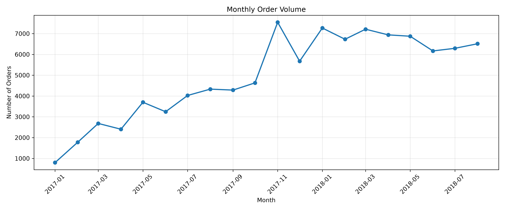
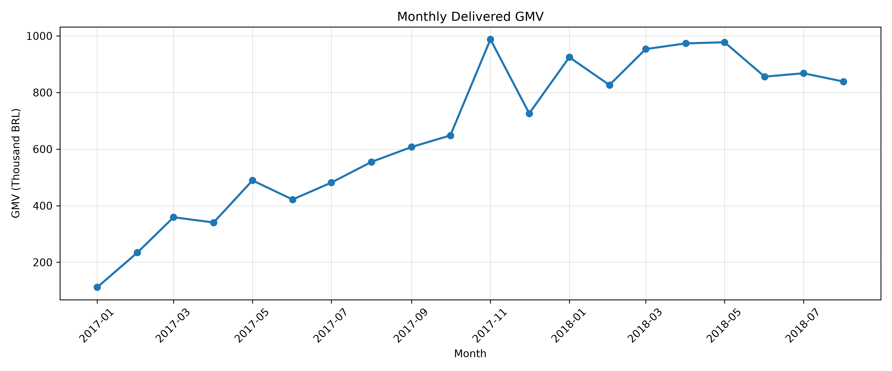
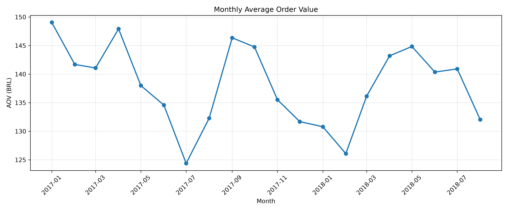
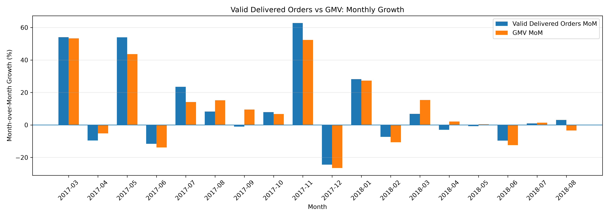

# Olist 电商数据分析｜第三阶段：平台经营表现分析

**分析期间：** 2017 年 1 月—2018 年 8 月（按订单购买月份）  
**分析口径：** GMV 指最终已送达订单的商品金额之和，不含运费；AOV = GMV ÷ 有商品明细的已送达订单数。金额单位为巴西雷亚尔（R$）。

## 核心发现

研究期内，Olist 的月度交易规模总体扩大，但**订单增长与交易额增长并不总是同步**。2017 年 11 月的高增长主要由订单数量推动；2017 年 9 月交易额增长更多来自客单价提高；2018 年 8 月则出现有效订单增加、GMV 下降的背离。由此，评价经营表现需要同时观察**订单规模、AOV 与最终订单状态**，而不能只看订单数。

| 分析基准 | 结果 |
|---|---:|
| 统计月份 | 20 个月 |
| 总订单数（各最终状态） | 99,092 |
| 有效已送达订单数 | 96,211 |
| 已送达商品 GMV | R$13,181,027.13 |
| 区间整体 AOV（GMV / 有效已送达订单） | R$137.00 |
| 最终取消订单数 / 占比 | 580 / 约 0.59% |

## 一、订单量增长显著，2018 年进入较高规模的波动区间

2017 年 2 月总订单量为 **1,780 单**，10 月升至 **4,631 单**，11 月进一步达到全区间峰值 **7,544 单**，环比增长 **62.90%**；12 月随即回落 **24.80%**。这意味着 11 月的跃升是一个突出但未持续的月度高点。

2018 年 1—8 月，月度订单量主要在 **6,000—7,300 单**之间波动。相比 2017 年初，交易规模明显更大；但不能因为曲线趋于平缓，就断言平台进入了“成熟期”。11 月的异常高点可能与季节性需求或促销有关，现有交易表没有活动投放证据，不能确定成因。

## 二、GMV 总体跟随订单规模变化，但客单价造成了重要偏离

月度 GMV 与订单量总体同向，但两条趋势并不完全重合。2017 年 11 月 GMV 达 **R$987,765.37**，为区间最高；2018 年 5 月虽然总订单仅 **6,873 单**，低于 2017 年 11 月的 7,544 单，GMV 仍达到 **R$977,544.69**，接近峰值。两个月的 AOV 分别为 **R$135.51** 与 **R$144.84**，较高的平均订单商品金额弥补了部分数量差距。

AOV 没有呈现持续上升趋势：2017 年 7 月为 **R$124.38**，9 月回升至 **R$146.36**；2018 年 2 月为 **R$126.08**，5 月回升至 **R$144.84**，8 月又降至 **R$132.04**。这些变化说明，月度 GMV 不仅取决于订单规模，也受到单笔订单商品金额变化的影响。**AOV 曲线的纵轴未从零开始，视觉波幅应结合实际数值解读。**

## 三、三个典型月份揭示了不同的增长结构

| 月份 | 有效已送达订单环比 | AOV 环比 | GMV 环比 | 主要表现 |
|---|---:|---:|---:|---|
| 2017-09 | -1.03% | +10.64% | +9.50% | 客单价提高抵消订单数下滑 |
| 2017-11 | +62.77% | -6.39% | +52.37% | 订单数量增长主导 GMV 增长 |
| 2018-08 | +3.12% | -6.31% | -3.38% | 订单增量不足以弥补客单价下滑 |

进一步以 **GMV = 有效已送达订单数 × AOV** 进行算术分解：

| 月份 | 订单数量变化对应的 GMV 变化 | AOV 变化对应的 GMV 变化 | GMV 净变化 |
|---|---:|---:|---:|
| 2017-09 | -R$5,689 | +R$58,389 | +R$52,700 |
| 2017-11 | +R$406,928 | -R$67,410 | +R$339,518 |
| 2018-08 | +R$27,057 | -R$56,434 | -R$29,377 |

*分解按“先固定上月 AOV 计算订单数量效应，再用本月订单数计算 AOV 效应”进行；基于未舍入数据计算，表中金额取整。这是对指标变化的算术归因，并不证明业务因果关系。*

**重点是 2018 年 8 月：** 有效订单增加 192 单，数量效应约为 **+R$27,057**，但 AOV 降低产生约 **-R$56,434** 的金额效应，最终 GMV 净减少 **R$29,376.82**。如果只看订单数，会把这个月误判为增长。

> **图表口径提示：** 此前上传的环比图蓝色柱采用全状态订单环比 `orders_mom_pct`；上表及量价分解采用有效已送达订单环比 `valid_orders_mom_pct`。若本地尚未按此前指导重绘，应以表中数据为准，不将旧图蓝色柱解释为有效订单环比。

## 四、值得调查的经营信号

**订单规模波峰。** 2017 年 11 月的量增价降显示订单规模是当月 GMV 增长的主要算术来源。但无法仅凭购买时间判断是否由折扣、营销投放或购物季带动。

**客单价波动。** 2017 年 9 月与 2018 年 8 月表现相反，提示商品品类、价格带、每单购买件数等结构变量可能很重要。仅有订单级 AOV 尚不能区分商品组合变化与同款商品价格变化。

**取消率抬升。** 2018 年 8 月最终取消率为 **1.29%**，是本次分析区间内的最高月；但该月靠近原始数据尾部，订单履约状态可能尚未充分观察，因此不能直接认定取消行为真实恶化。

## 五、经营层面的结论

1. **经营规模扩大，但增长质量不能只用订单量衡量。** 在不同月份，有效订单数与 AOV 的方向可能相反。
2. **2017 年 11 月属于数量驱动的交易高峰；2017 年 9 月属于客单价驱动的增长；2018 年 8 月体现数量与金额表现背离。** 三者适合用作经营诊断的典型案例。
3. **后续分析应优先验证 AOV 的构成变化。** 具体可结合品类销售占比、平均商品明细金额和每单商品明细数量，判断变化集中在哪一层；不能提前把相关性写成原因。
4. **风险判断应考虑数据观察期。** 对样本末期的取消率及已送达订单占比，需要保留截断风险说明。

## 分析边界与依据

- 数据覆盖：2016 年早期月份较稀疏、2018 年 9—10 月数据明显不完整，因此趋势分析选择 2017 年 1 月至 2018 年 8 月；**环比结论主要使用 2017 年 3 月至 2018 年 8 月的 18 个可比较月份**。
- 指标范围：按购买月份归属订单的**最终状态**，不是每月末实时履约状态；GMV 不含运费，也不等于平台净收入、利润或实收款。
- 证据依据：`sql/05_business_performance.sql` 的月度查询结果、`data/processed/monthly_business_performance.csv`、`notebooks/02_business_analysis.ipynb` 及上述四张图。分析为描述性研究，缺少营销、流量、价格实验等因果证据。
