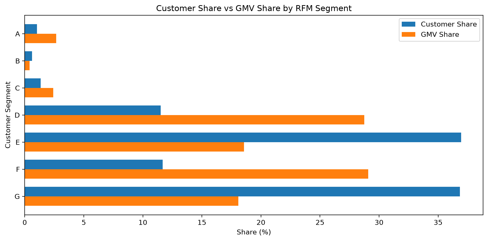
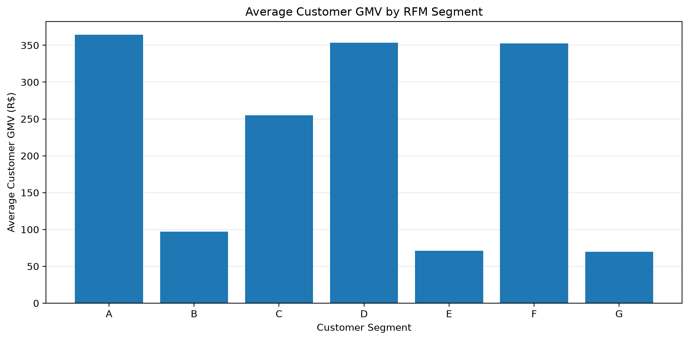

# Olist 电商平台｜第五阶段：用户购买行为与 RFM 价值分析

> 分析范围：订单购买时间 2017-01-01（含）至 2018-09-01（不含），20 个自然月。  
> 分析对象：最终状态为 `delivered` 且有商品明细的订单；用户以 `customer_unique_id` 去重。  
> 金额口径：商品 GMV（`SUM(order_items.price)`），不含运费，不代表平台收入、利润或客户终身价值。  
> 观察基准日：2018-09-01。  
> 相关工程：`sql/07_customer_analysis.sql`、`notebooks/04_customer_analysis.ipynb`。

## 1. 执行摘要

观察期内有 **93,104 名购买用户、96,211 笔有效已送达订单、R$13,181,027.13 商品 GMV**。其中 **2,789 名复购用户（3.00%）**，其余 97.00% 的用户仅完成一次有效购买，说明样本交易主要由单次购买客户构成。

按样本分位数与购买频次构建的七类 RFM 用户群中，**D、F 两类高消费单次用户合计 21,601 人（23.20%），贡献约 57.84% 的商品 GMV**。这一结构使其成为重点研究的用户群，但并不意味着向其投放营销资源必然产生正向增量。

本阶段的业务建议是：优先理解高消费单次用户的品类、购买周期与服务体验；对近期复购用户设计小规模可测量的维护策略；其他群体采用差异化、成本可控的运营测试。所有建议均为描述性分析衍生的待验证方向。

## 2. 数据范围与质量控制

- **订单筛选**：最终 `order_status='delivered'`，购买时间位于主分析区间，且订单存在商品明细。
- **订单金额聚合**：先将 `order_items` 聚合到 `order_id`，再聚合到 `customer_unique_id`，避免一个订单多商品造成订单数量膨胀。
- **用户粒度**：每位真实客户一行；`customer_id` 不是用于长期识别同一客户的粒度。
- **验收数据**：用户数 93,104；唯一用户数 93,104；订单数 96,211；商品 GMV R$13,181,027.13。七类分组人数、订单数与金额汇总全部守恒。

## 3. 用户购买频次与复购情况

| 购买次数 | 用户数 | 用户占比 | 订单数 | GMV（R$） | GMV 占比 | 人均累计 GMV（R$） |
|---|---:|---:|---:|---:|---:|---:|
| 1 次 | 90,315 | 97.00% | 90,315 | 12,455,672.09 | 94.50% | 137.91 |
| 2 次 | 2,562 | 2.75% | 5,124 | 628,326.08 | 4.77% | 245.25 |
| 3 次 | 180 | 0.19% | 540 | 65,869.53 | 0.50% | 365.94 |
| 4 次及以上 | 47 | 0.05% | 232 | 31,159.43 | 0.24% | 662.97 |

复购用户定义为**观察期内有至少两笔最终已送达、有商品明细订单**的用户；复购用户数 2,789，占购买用户数的 3.00%，贡献商品 GMV **R$725,355.04（约 5.50%）**。

复购用户的人均累计消费通常高于单次购买用户，但这部分差异受到订单数量的机械影响，不能据此断言其**单笔**客单价更高，也不能直接推断平台留存能力的好坏。

## 4. RFM 指标与评分规则

**R（Recency）**：观察基准日与最后一次有效购买日期的间隔天数（越小越近）。**F（Frequency）**：观察期内有效订单次数。**M（Monetary）**：观察期内累计商品 GMV，不含运费。

- R 值范围 3～604 天；F 值范围 1～15 次；人均累计 M 为 **R$141.57**。
- R 分位数：P25=117 天、P50=221 天、P75=348 天、P90=466 天。
- M 分位数：P25=R$47.65、P50=R$89.70、P75=R$154.17、P90=R$279.99。

| 得分 | R（天；越小越高） | F（次） | M（R$；越大越高） |
|---|---|---|---|
| 4 | ≤117 | 不设 4 分 | >154.17 |
| 3 | 118～221 | ≥3 | (89.70,154.17] |
| 2 | 222～348 | 2 | (47.65,89.70] |
| 1 | >348 | 1 | ≤47.65 |

因为 97.00% 的用户只有一笔有效购买，F 不使用五等分或四等分，而采用**1 次、2 次、3 次及以上**的业务离散评分；R 和 M 使用四级分位数评分。分层不简单累加 R、F、M 分数。

评分分布已验收：R 四组 23,127／23,297／23,129／23,551；F 三组 90,315／2,562／227；M 四组 23,286／23,271／23,271／23,276。各维合计均为 93,104。

## 5. 七类用户分层及交易贡献

**分层规则**：优先区分是否复购（F≥2 分对应至少 2 次购买），再按 R≥3 分（最近购买间隔 ≤221 天）和 M=4 分（累计消费金额 >R$154.17）区分。此处的“近期”和“高消费”仅指**本样本相对阈值**。

| 类别 | 定义 | 用户数 | 用户占比 | 订单数 | 商品 GMV（R$） | GMV 占比 | 人均累计 GMV（R$） | 平均 R（天） |
|---|---|---:|---:|---:|---:|---:|---:|---:|
| A | 近期高消费复购 | 964 | 1.04% | 2,122 | 351,060.67 | 2.66% | 364.17 | 115.28 |
| B | 近期其他复购 | 575 | 0.62% | 1,175 | 55,778.02 | 0.42% | 97.01 | 114.63 |
| C | 非近期复购 | 1,250 | 1.34% | 2,599 | 318,516.35 | 2.42% | 254.81 | 353.95 |
| D | 近期高消费单次 | 10,728 | 11.52% | 10,728 | 3,789,929.72 | 28.75% | 353.27 | 114.31 |
| E | 近期其他单次 | 34,413 | 36.96% | 34,413 | 2,447,684.77 | 18.57% | 71.13 | 114.27 |
| F | 非近期高消费单次 | 10,873 | 11.68% | 10,873 | 3,833,617.12 | 29.08% | 352.58 | 366.60 |
| G | 非近期其他单次 | 34,301 | 36.84% | 34,301 | 2,384,440.48 | 18.09% | 69.52 | 364.71 |
| **合计** | — | **93,104** | **100%（舍入前）** | **96,211** | **13,181,027.13** | **100%（舍入前）** | **141.57** | — |

**核心发现：**

1. **高消费单次用户（D+F）**：21,601 人，占总用户 23.20%，贡献 **R$7,623,546.84（约 57.84%）** 商品 GMV，反映样本交易金额集中于高额单次购买。
2. **普通单次用户（E+G）**：68,714 人，占总用户 73.80%，GMV 份额约 36.66%，规模大但累计消费相对较低。
3. **复购用户（A+B+C）**：2,789 人，占总用户 3.00%，贡献约 5.50% 的商品 GMV。值得深入分析，但总体交易贡献有限。
4. **近期与非近期**：D 和 F 人均累计 GMV 接近，差别主要在最后购买时间。其背后的品类构成、购买周期和是否有机会再次购买仍需其他数据验证。

## 6. 可视化与解释

### 图 1：各分层用户占比与 GMV 占比

D、F 的 GMV 份额明显大于用户份额；E、G 的用户份额明显大于 GMV 份额。图中 A～G 对应第 5 节七类用户，柱状条表示两种不同分母下的占比。

### 图 2：各分层人均累计商品 GMV

A、D、F 的人均累计 GMV 均在 R$350 左右或以上；B、E、G 相对较低。该图展示的是**观察期每位用户的累计商品金额**，不是单笔订单 AOV，也不是生命周期价值。

两张图已与用户执行的 `5.5.2` SQL 汇总结果逐项对比，数据与排序一致。

## 7. 业务建议与后续验证

| 优先研究方向 | 数据依据 | 建议的下一步验证 |
|---|---|---|
| 高消费单次用户的再次购买机会 | D+F 贡献约 57.84% GMV | 研究购买品类、客单组成、购买时间与后续可观察购买行为；若可触达，设计带对照组的小规模测试。 |
| 近期高消费复购用户的维护 | A 类 964 人、人均累计 GMV R$364.17 | 研究其品类偏好、服务体验与后续复购，避免仅凭累计金额推定增量价值。 |
| 非近期高消费用户的体验排查 | F 类 10,873 人、GMV 占比 29.08% | 联合第六阶段的配送延迟及评价数据，检查关联，但不将关联误称因果。 |
| 其他单次用户的成本控制 | E+G 占用户 73.80% | 在明确渠道与成本后再评估触达、优惠或推荐策略的可行性。 |

## 8. 重要局限性

1. **截断与观察期偏差**：数据覆盖有限，不同首次购买时间用户的复购观察时长不相同；“非近期”并不等价于已经流失。
2. **仅有交易数据**：没有浏览、加购、活动触达及完整渠道成本，不能判断转化链路或干预收益。
3. **金额不等于利润**：RFM 的 M 是不含运费的商品交易额，不代表平台净收入、利润或预测 CLV。
4. **RFM 为样本相对分组**：阈值依赖当期数据分布，重新选择时间窗口可能改变分组。高消费与购买频次也存在结构性关联。
5. **不做因果推断**：群体之间的金额或配送体验差异只能支持描述性结论，运营效果需要更严格的设计和验证。
6. **代码验收边界**：本阶段依赖用户在本地执行 SQL 的结果及上传图表进行数值核验，不等于对本地 SQL、Notebook 完整源码开展静态审查或从空库复跑。

## 9. 文件与复现索引

- `sql/07_customer_analysis.sql`：5.1 用户购买行为；5.2 RFM 构建；5.3 分布与分位数；5.4 评分；5.5 分层及汇总。
- `data/processed/customer_rfm_segments.csv`：从 `5.5.2` SQL 导出的七类用户汇总（8 列、有字段名）。
- `notebooks/04_customer_analysis.ipynb`：5.6 数据读取、汇总数据校验及两张图表输出。
- `reports/figures/customer_segment_comparison.png`：用户份额与 GMV 份额。
- `reports/figures/customer_segment_avg_gmv.png`：各用户分层人均累计 GMV。
- `reports/customer_analysis_summary.md`：本报告。

**阶段结论：第五阶段 SQL 指标、分层计算、可视化及业务分析已经完成用户运行结果层面的验收。下一阶段为配送效率和用户评分关联分析。**
