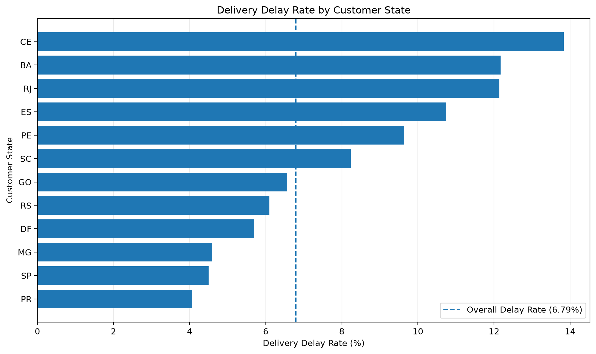
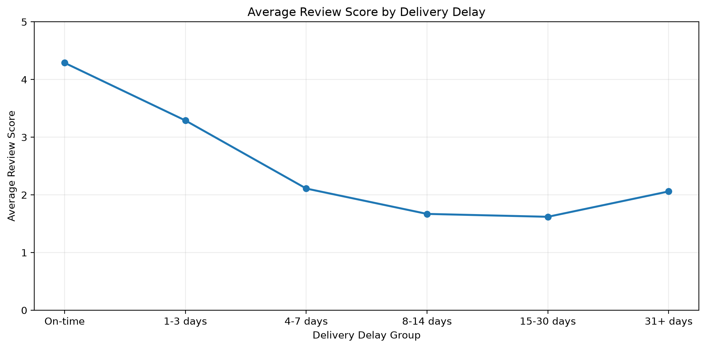
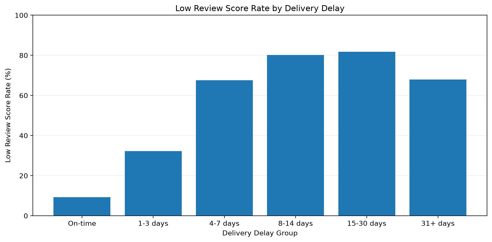

# Olist 电商平台｜第六阶段：配送效率与用户体验分析

> 编写日期：2026-11-19  
> 数据期间：购买时间 2017-01-01（含）至 2018-09-01（不含），按订单最终状态归类。  
> 范围：最终 `delivered` 且有效购买—签收时间、有效预计送达日期的订单。  
> 工程关联：`sql/08_delivery_analysis.sql`、`notebooks/05_delivery_review.ipynb`。  
> 数值来源：用户在本次开发中执行 SQL 提供的汇总结果，三张已上传图表经数值与趋势核对；尚未取得完整 SQL/Notebook 文件做静态审核或全链路独立复跑。

## 1. 执行摘要

主分析期内有 **96,211 笔最终已送达订单**；其中 **96,203 笔**具备有效的购买至签收时间，可用于本阶段配送分析。平均实际配送 **12.54 天**；**6,531 笔延迟订单**，延迟率 **6.79%**，延迟订单平均延误 **10.62 天**。

延迟问题呈现显著的地区和体验差异：RJ 州延迟率 **12.14%**，延迟订单 **1,495 笔**，同时具有较高业务规模；准时订单平均评分 **4.29 分**，延迟订单为 **2.27 分**，二者低评分率分别为 **9.24%** 和 **62.43%**（均以有评价订单为分母）。配送延迟是值得优先调查和监测的体验风险信号，但上述差异不能视为因果效应。

本阶段建议先按**延迟订单数量 × 延迟率 × 用户评价表现**确定排查优先级，重点复核 RJ 等高风险地区的物流链路，并对超过预计送达日期的订单设立可监控的分层处理流程。在业务验证前，不宣称任何策略能带来确定的评分或留存增量。

## 2. 分析范围、字段和口径

- **分析粒度：** `order_id`，每笔订单最多计数一次；买家州从 `customers.customer_state` 获取。
- **时间范围：** 购买时间 `>= 2017-01-01` 且 `< 2018-09-01`；按订单**最终**状态 `delivered` 筛选，而非购买当日状态。
- **有效实际配送时长：** `order_delivered_customer_date` 非空，且不早于 `order_purchase_timestamp`。实际配送时长为两时间戳之差（秒 / 86,400，单位天）。
- **配送延迟：** `DATE(order_delivered_customer_date) > DATE(order_estimated_delivery_date)`，同日送达算准时；延迟天数为两日期的 `DATEDIFF`。该口径与精确到分钟的时间戳逾期不同。
- **有评价订单：** `order_reviews` 先按 `order_id` 聚合；多条评价取原始 `review_score` 的算术平均；订单间再等权计算平均评分。
- **低评分：** 订单平均评分严格小于 **3** 分；低评分率分母为该组**有评价订单**数，无评价订单不作为零分。
- **分析性质：** 描述性分析，未估计统计显著性、控制混杂因素或进行因果识别；这些工作保留至未来统计分析阶段。

## 3. 配送数据质量检查

| 检查项 | 订单数 | 解释 |
|---|---:|---|
| 主分析期最终已送达订单 | 96,211 | 与前期经营分析吻合 |
| 缺少实际签收时间 | 8 | 排除出购买至签收的时长分析 |
| 缺少预计送达日期 | 0 | 没有因预计日期缺失而减少样本 |
| 缺少承运商交接时间 | 2 | 本阶段不以交接时间为必要条件 |
| 实际签收早于购买时间 | 0 | 无此异常 |
| 承运商交接早于购买时间 | 165 | 相关时间戳异常，保留供独立调查 |
| 实际签收早于承运商交接 | 19 | 相关时间戳异常，保留供独立调查 |
| **配送分析有效样本** | **96,203** | 96,211 - 8；与后续汇总相符 |

注：165 和 19 两类交接时间异常可能涉及重叠订单，不应相加当成去重异常订单数。它们不自动使购买—签收时间无效。

## 4. 平台配送效率与延迟分布

| 指标 | 结果 |
|---|---:|
| 有效配送订单 | 96,203 |
| 平均配送时长 | 12.54 天 |
| 最短 / 最长配送时长 | 0.53 / 209.63 天 |
| 准时或提前送达 | 89,672 |
| 延迟送达 | 6,531 |
| 准时率 / 延迟率 | 93.21% / 6.79% |
| 延迟订单平均延迟 | 10.62 天 |

### 4.1 实际配送时长分布

| 实际配送时长 | 订单数 | 订单占比 | 延迟数 | 组内延迟率 |
|---|---:|---:|---:|---:|
| 0–3 天（不含 3） | 4,753 | 4.94% | 0 | 0.00% |
| 3–7 天（不含 7） | 21,284 | 22.12% | 61 | 0.29% |
| 7–14 天（不含 14） | 40,112 | 41.70% | 317 | 0.79% |
| 14–30 天（不含 30） | 25,552 | 26.56% | 2,575 | 10.08% |
| 30 天及以上 | 4,502 | 4.68% | 3,578 | 79.48% |
| **合计** | **96,203** | **100.00%** | **6,531** | **6.79%** |

**解读：** 约 68.76% 的订单在购买后 14 天内签收；实际配送达到 30 天及以上的订单仅占 4.68%，却对应 3,578 笔延迟订单（全部延迟订单的约 **54.78%**）。这里的“配送 30 天以上”不是“相较承诺时间延迟 30 天以上”。

### 4.2 相对预计送达日期的延迟程度

| 延迟天数 | 延迟订单数 | 占延迟订单比例 | 组内平均延迟 | 组内最大延迟 |
|---|---:|---:|---:|---:|
| 1–3 天 | 1,869 | 28.62% | 1.83 天 | 3 天 |
| 4–7 天 | 1,802 | 27.59% | 5.52 天 | 7 天 |
| 8–14 天 | 1,478 | 22.63% | 10.59 天 | 14 天 |
| 15–30 天 | 1,038 | 15.89% | 20.39 天 | 30 天 |
| 31 天及以上 | 344 | 5.27% | 55.71 天 | 188 天 |
| **合计** | **6,531** | **100.00%** | **约 10.62 天** | **188 天** |

延迟 7 天以内占 **56.21%**；延迟 15 天及以上（包括 15 天）的订单占 **21.16%**。延迟组中存在明显的长尾风险，极端订单仍需进一步核实业务背景。

## 5. 各州配送效率差异

按买家州归属订单；下表展示订单量不少于 1,000 的地区（避免只凭极小样本的比例排序）。

| 州 | 有效配送订单数 | 平均配送天数 | 平均预计配送周期 | 延迟订单数 | 州内延迟率 |
|---|---:|---:|---:|---:|---:|
| SP | 40,399 | 8.74 | 19.06 | 1,817 | 4.50% |
| RJ | 12,310 | 15.30 | 26.27 | 1,495 | 12.14% |
| MG | 11,319 | 11.98 | 24.45 | 519 | 4.59% |
| RS | 5,327 | 15.29 | 28.42 | 325 | 6.10% |
| PR | 4,903 | 11.97 | 24.50 | 199 | 4.06% |
| SC | 3,537 | 14.95 | 25.68 | 291 | 8.23% |
| BA | 3,253 | 19.33 | 29.40 | 396 | 12.17% |
| DF | 2,074 | 12.94 | 24.21 | 118 | 5.69% |
| ES | 1,992 | 15.78 | 25.53 | 214 | 10.74% |
| GO | 1,950 | 15.61 | 26.97 | 128 | 6.56% |
| PE | 1,587 | 18.45 | 30.93 | 153 | 9.64% |
| CE | 1,273 | 21.24 | 31.17 | 176 | 13.83% |

- **RJ**：占有效配送订单 **12.80%**，却占全部延迟订单约 **22.89%**，是具有规模与风险双重特征的优先调查对象。
- **SP**：占全部有效配送订单 **41.99%**，州内延迟率 **4.50%**，但因规模大仍有 **1,817** 笔延迟订单，不能只按延迟率忽略其绝对数量。
- **CE、BA**：州内延迟率分别为 **13.83%**、**12.17%**，需结合预计配送周期、商家分布与实际物流服务区研究原因。
- 其他低样本州的极端比率应结合样本量解释，不能直接与 SP、RJ 等州作同等确定性的排名。

*图 1：买家州配送延迟率（有效配送订单不少于 1,000）；虚线为整体延迟率 6.79%。数据来源：6.3.1 地区配送效率查询。*

## 6. 配送延迟与用户评分

### 6.1 准时与延迟订单对比

| 指标 | 准时/提前 | 延迟 |
|---|---:|---:|
| 总订单 | 89,672 | 6,531 |
| 有评价订单 | 89,182 | 6,378 |
| 无评价订单 | 490 | 153 |
| 评价覆盖率 | 99.45% | 97.66% |
| 订单平均评分 | **4.29** | **2.27** |
| 低评分订单（订单均分 < 3） | 8,240 | 3,982 |
| 低评分率（有评价订单分母） | **9.24%** | **62.43%** |

延迟订单平均评分较准时订单低 **2.02 分**，低评分率高 **53.19 个百分点**，约为准时订单的 **6.76 倍**。在有评价的订单中，全部低评分订单数为 12,222；其中延迟订单贡献约 **32.58%**。评价覆盖率虽高但组间不同，结论仅针对已评价订单。

### 6.2 延迟程度与评分变化

| 配送状态 | 订单数 | 有评价订单数 | 平均评分 | 低评分率 |
|---|---:|---:|---:|---:|
| 准时送达 | 89,672 | 89,182 | 4.29 | 9.24% |
| 延迟 1–3 天 | 1,869 | 1,851 | 3.29 | 32.20% |
| 延迟 4–7 天 | 1,802 | 1,748 | 2.11 | 67.56% |
| 延迟 8–14 天 | 1,478 | 1,446 | 1.67 | 80.22% |
| 延迟 15–30 天 | 1,038 | 1,005 | 1.62 | 81.79% |
| 延迟 31 天及以上 | 344 | 328 | 2.06 | 67.99% |

*图 2：不同延迟分组的订单平均评价分数。横轴是有序分组、非等间隔连续时间。数据来源：6.4.3 延迟程度评分查询。*

*图 3：不同延迟分组中，平均评分低于 3 分的订单比例。数据来源：6.4.3 延迟程度评分查询。*

- 延迟 **1–3 天**的低评分率已升至 **32.20%**；延迟 **4–7 天**达到 **67.56%**。
- 延迟 **8–30 天**的两个组低评分率均超过 **80%**，风险信号强。
- 延迟 **31 天及以上**组的评分反而回升（均分 2.06 vs. 15–30 天组的 1.62；低评分率 67.99% vs. 81.79%），**不能声称延迟天数与评分之间严格单调**。该组有评价订单仅 328 笔，结构与抽样差异均可能影响结果，现阶段原因未知。

## 7. 业务诊断与初步行动建议

| 优先级 | 可行动方向 | 数据依据 | 进一步验证 |
|---|---|---|---|
| P1 | 针对 RJ 的高延迟风险开展地区与商家物流链路排查 | 1,495 笔延迟订单、12.14% 延迟率，占全部延迟约 22.89% | 细分目的地城市、发货州、品类/商家及承运商信息的可用性 |
| P1 | 监控预计送达日期后的延迟分层并建立客服告警候选规则 | 延迟订单低评分率 62.43%；延迟 4–7 天组 67.56% | 结合可行动的物流节点，在更早的预测时点验证预警有效性 |
| P2 | 分别调查长运输时长与长延迟时长的订单 | 30+ 天实际配送组有 3,578 笔延迟；31+ 天实际逾期组有 344 笔 | 核对极端记录、运输路径、退换货和数据时间戳质量 |
| P2 | 对高订单规模地区同步监控绝对延迟笔数 | SP 延迟率低但延迟订单数 1,817 | 与 RJ 分别设置“总量”和“风险率”两类指标 |

以上均为候选行动建议，而非效果已证实的运营方案。当前数据不包含足以验证处理措施效果的实验或服务成本信息。

## 8. 方法局限与验收边界

1. **观察期和最终状态偏差：** 仅分析最终已送达订单；取消、未送达及窗口末尾仍在途订单未纳入，可能低估真实履约风险。
2. **时间与地区信息限制：** 配送延迟按日期比较；买家州不能代替真实物流线路，也不能推断具体承运商责任。
3. **相关非因果：** 评分还受商品、售后、卖家、地区等因素影响；没有对混杂因素做调整，也没有显著性检验。
4. **评价选择：** 缺失评价不是零分；准时与延迟组覆盖率分别 99.45% 和 97.66%，缺失机制可能不同。
5. **重复评价：** 对同一订单多条原始评分先取均值，再按订单等权；低评分按订单平均评分 `< 3` 定义，不代表“每条评价 ≤ 2”。
6. **质量异常：** 承运商交接时间异常未用于这次筛选；后续如计算仓内/承运商段时长，需单独筛选有效链路。
7. **审核范围：** 已对用户提供的 SQL 汇总数值和三张图作逻辑核对；未对实际本地 `.sql`、`.ipynb` 源文件进行独立静态审查或端到端复跑。

## 9. 阶段交付与复现说明

- SQL：`sql/08_delivery_analysis.sql`，包含 6.1 数据质量、6.2 配送时长和延迟、6.3 买家州、6.4 配送评分查询及订单级联合视图 `v_delivery_review_analysis`。
- SQL 导出：`data/processed/delivery_state_summary.csv`（6.3.1，27 行）、`data/processed/delivery_review_by_delay.csv`（6.4.3，6 行）。
- Notebook：`notebooks/05_delivery_review.ipynb`，生成并保存三张可视化图。
- 阶段报告：`reports/delivery_analysis_summary.md`；图片位于 `reports/figures/`，使用相对路径引用。
- 查询执行及图表保存由用户在本地完成并上传结果；**本交付包仅包含本阶段报告、已上传的三张图片及更新后的日志和进度文档**，不包含未提供的原始 SQL、Notebook 或 CSV 文件。

**本轮范围：第五阶段客户价值分析、第六阶段配送效率与用户体验分析均已完成阶段性数据与图表核验；第七阶段统计分析和最终综合报告尚未开展。**
