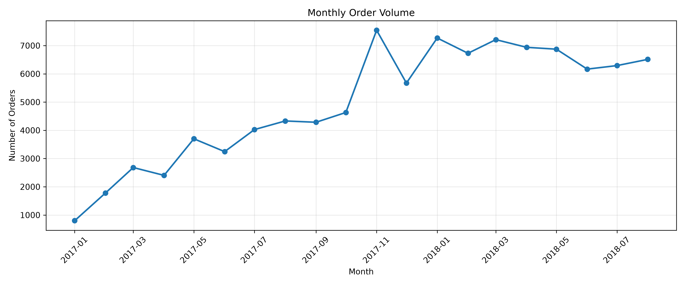
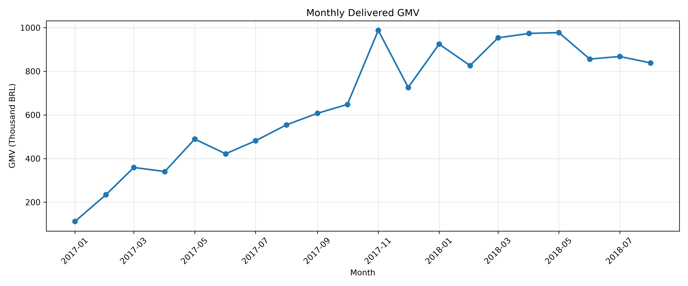
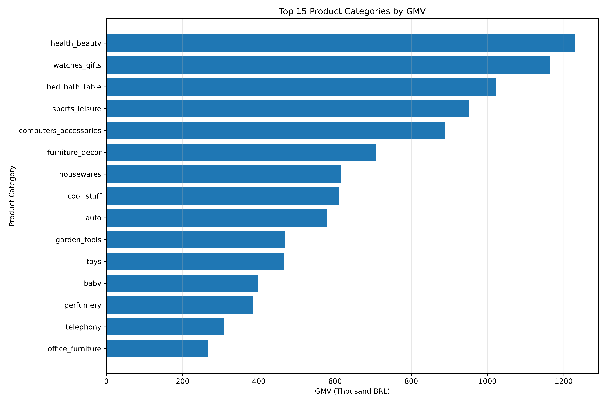
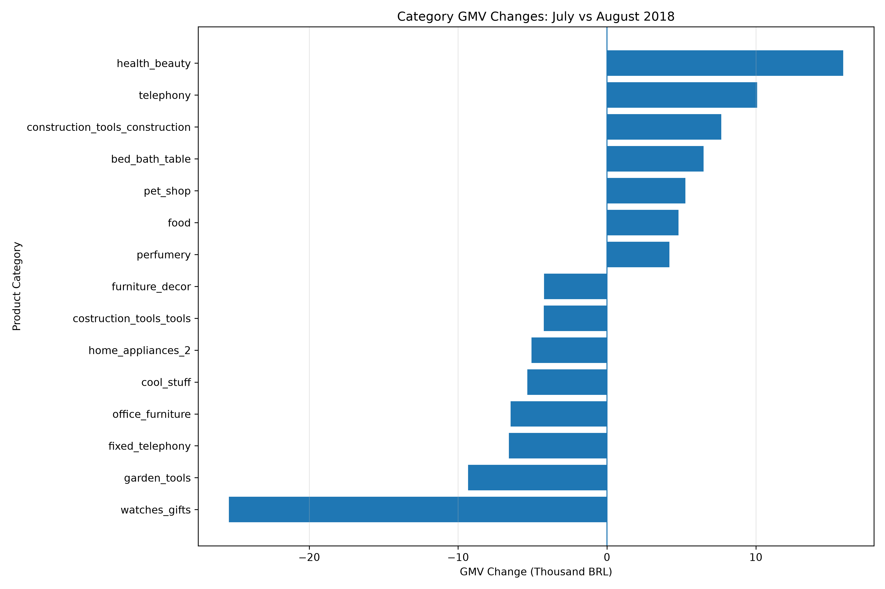
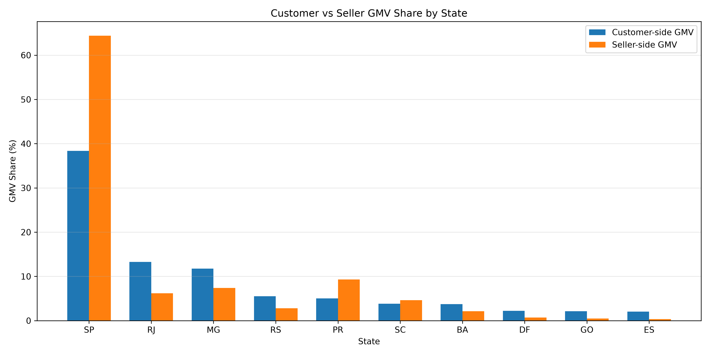
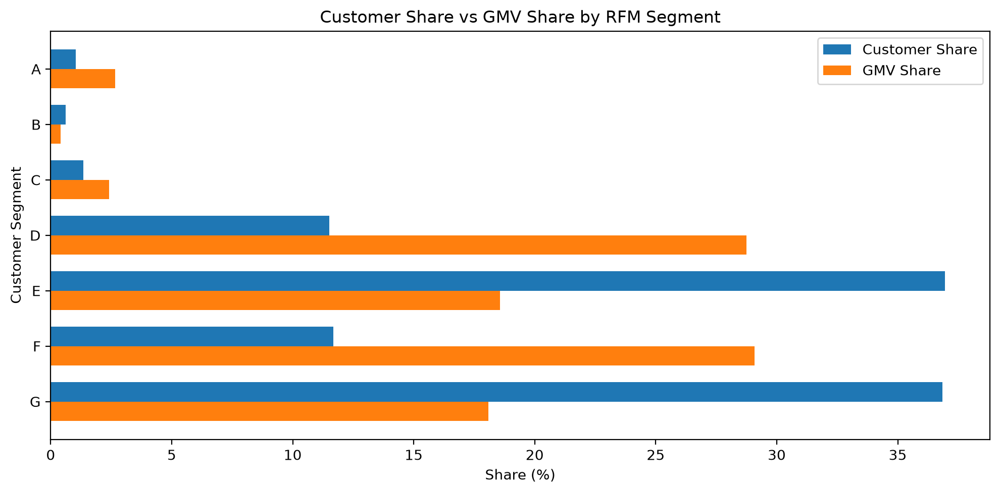
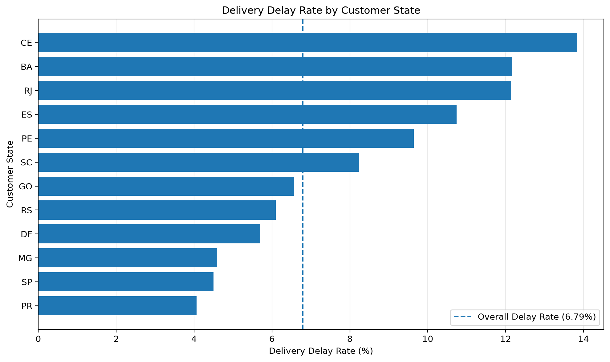
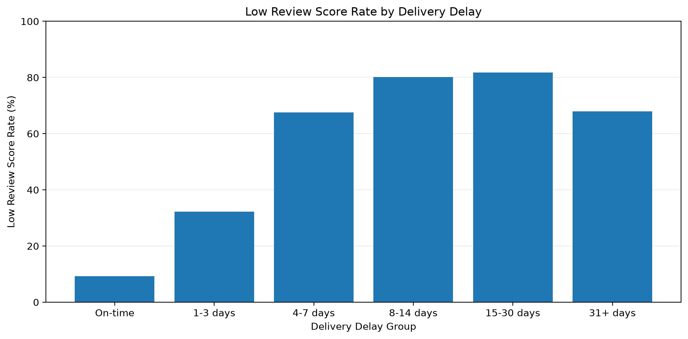
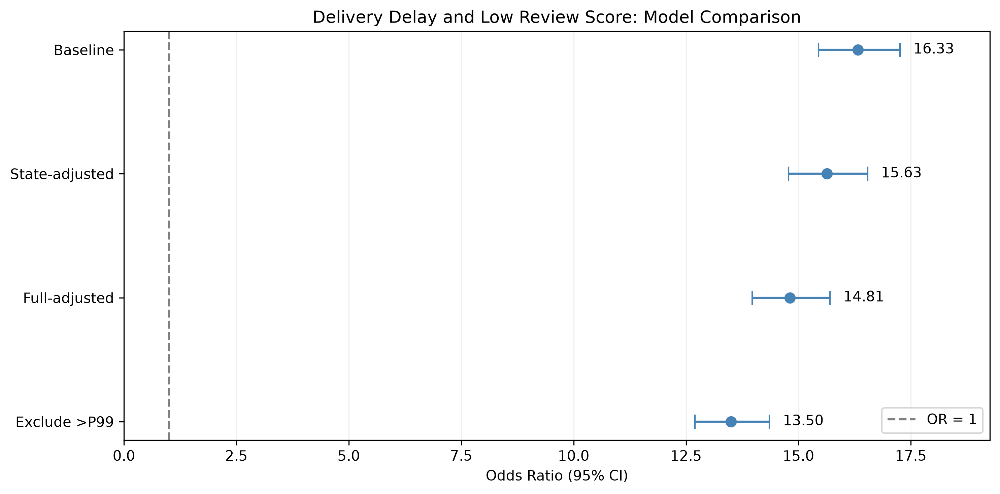

# Olist 电商平台经营与用户体验分析报告

**Olist E-Commerce Business Performance & Customer Experience Analysis**

> **研究期间：** 2017-01-01（含）至 2018-09-01（不含），以订单购买日期为准  
> **数据来源：** Olist Brazilian E-Commerce Public Dataset  
> **技术工具：** MySQL、Python、Pandas、Matplotlib、SciPy、statsmodels  
> **编写日期：** 2026-11-19  
> **报告性质：** 历史交易数据分析与业务诊断；非因果效果评估或实时运营监控报告

---

## 1. Executive Summary｜执行摘要

本项目使用 Olist 巴西电商公开交易数据，从**平台经营、商品与地区结构、客户价值、配送体验**四条业务主线展开分析，并运用假设检验与多变量 Logistic 回归进一步考察配送延迟和低评分的关系。主分析区间共涉及 **99,092 笔全部最终状态订单**，其中 **96,211 笔最终已送达且具有商品明细**，对应商品交易额 **R$13,181,027.13**（不含运费）。

**核心发现及其业务含义：**

1. **交易规模增长不等于交易额同步增长。** 2018 年 8 月有效已送达订单环比增长 **3.12%**，但商品 GMV 下降 **3.38%**。AOV 下降 **6.31%**，主要在算术结构上反映为平均商品明细金额降低。经营分析应同时检查订单数量、AOV、商品结构与订单最终状态。
2. **商品和市场集中，商家集中度相对较低。** Top 5 品类贡献 **39.88%** 商品 GMV，买家侧 SP/RJ/MG 三州贡献 **63.40%**；而 Top 5 商家仅贡献 **7.73%**。SP 商家侧 GMV 占比 **64.39%**，与其买家侧占比 **38.36%** 明显不同，提示地区供需分布和履约链路值得联合研究。
3. **样本内购买以单次购买为主。** **93,104 名**购买客户中，仅 **2,789 名（3.00%）**拥有至少两笔有效订单。RFM 分层显示，两类高消费单次客户（D、F）合计 **21,601 人**，贡献约 **57.84%** 商品 GMV。它们值得开展购买周期与再次购买机会研究，但不能据此推断运营触达一定有增量收益。
4. **配送延迟与较低评价存在显著关联。** 在 **95,560 笔有评价、配送时间有效的订单**中，准时和延迟订单的低评分率分别为 **9.24%** 与 **62.43%**。控制买家州、商品金额和购买月份后，延迟变量的调整后优势比（OR）为 **14.81**（95% CI：**13.97–15.70**；p < 0.001）；调整评分阈值、排除极端配送时长订单后，关联方向依然一致。**这些结果不构成“配送延迟导致低评分”的因果证明。**

综合分析建议：优先建设**配送异常与评分联合监控**，重点研究有规模且延迟风险较高的地区；同步追踪**GMV 的量价与商品组合变化**；对高消费单次客户制定**可验证、低成本**的后续分析与小规模试点方案。

### 1.1 核心指标速览

| 指标 | 结果 | 统计口径 |
|---|---:|---|
| 主分析期订单数 | 99,092 | 所有最终状态、按购买时间筛选 |
| 有效已送达订单数 | 96,211 | 最终 delivered，且有商品明细 |
| 商品 GMV | R$13,181,027.13 | 已送达商品 `price` 总和，不含运费 |
| 整体 AOV | R$137.00 | 商品 GMV / 有效已送达订单 |
| 购买客户数 | 93,104 | `customer_unique_id` 去重 |
| 样本内复购客户占比 | 3.00% | 有至少两笔有效订单的客户占比 |
| 有效配送订单数 | 96,203 | 已送达且购买—签收时间有效 |
| 配送延迟率 | 6.79% | 延迟 6,531 / 有效配送 96,203 |
| 准时 / 延迟订单低评分率 | 9.24% / 62.43% | 分母分别为各组**有评价**订单 |
| 延迟与低评分：完整调整模型 OR | 14.8098 | 控制买家州、`log1p(商品金额)`、购买月份 |

> **重要区分：** GMV 是商品成交金额统计指标，**不是**平台收入、利润或实际收款。表中分母随研究问题而变化，不能把 99,092、96,211、96,203、95,560 当作同一分析总体。

---

## 2. Business Background｜业务背景与研究问题

Olist 数据集包含客户、订单、订单商品、支付、评价、商品、商家、地理位置和商品类别翻译等记录，可支持对平台历史交易及履约结果的分析。本项目模拟电商业务数据分析师的工作：先明确指标，再完成数据质量检查和分析建模，最后将统计结果转换为可检验的业务问题与候选行动。

本报告聚焦四个决策问题：

- **经营表现：** 平台交易规模如何变化？GMV 的月度变化是由有效订单量还是 AOV 变化所体现？
- **商品与地区：** 哪些品类、商家及区域贡献了主要商品 GMV？供需地域结构是否对称？
- **客户价值：** 购买频次和累计交易贡献如何分布？哪些客户群值得进一步研究？
- **履约体验：** 配送延迟在哪些地区更突出？延迟与评价是否存在显著关联，其结果是否稳健？

本项目**没有网页浏览、加购、曝光、投放或完整实时物流事件数据**，因此不构建虚构的访问—购买漏斗，也不将交易分析包装为完整的用户行为埋点分析。

---

## 3. Data & Methodology｜数据、指标与分析方法

### 3.1 数据范围与样本构建

原始 Olist 数据由 9 个 CSV 文件组成，并导入 MySQL 的 9 张原始表。订单原始表共有 **99,441 行**；考虑到早期月份稀疏及末端月份记录不足，主要趋势与横向业务分析使用 **2017 年 1 月至 2018 年 8 月**的 20 个自然月。环比分析主要采用其中具备可比较基数的 18 个月（2017 年 3 月至 2018 年 8 月）。

| 分析层次 | 样本量 | 适用分析 |
|---|---:|---|
| 全部原始订单 | 99,441 | 数据检查、完整性核验 |
| 主期间全部最终状态订单 | 99,092 | 总订单、取消率、月度经营趋势 |
| 主期间有效已送达且有商品明细的订单 | 96,211 | 商品 GMV、AOV、品类、地区、客户购买 |
| 主期间有效订单商品明细 | 109,880 行 | 品类、商家、商品金额结构 |
| 主期间唯一购买客户 | 93,104 人 | 购买频次、RFM |
| 有效购买—签收时间订单 | 96,203 | 配送时长、延迟率、地区履约 |
| 上述样本中有有效评价的订单 | 95,560 | 评分差异检验、Logistic 回归 |

**观察窗口说明：** 订单按购买月份归属，但使用的是数据中记录的**最终订单状态**，并非当月月底的实时状态。区间末端的取消率与已送达占比可能受到履约观察期截断影响。

### 3.2 数据质量控制与粒度处理

数据处理遵循“**保留原始记录、建立清洗视图、按指标选择有效样本**”的原则。

- **避免一对多连接膨胀：** `order_items`、`order_payments`、`order_reviews` 可能存在每订单多条记录，分别聚合到订单粒度后，再与订单表连接，避免金额和订单数重复计算。
- **明确客户粒度：** 使用 `customer_unique_id` 表示去重客户，而不是把每次订单绑定的 `customer_id` 直接当作长期唯一用户。
- **处理评价记录：** 同一订单有多条评价时，先按订单对原始评分取均值；组间分析再按订单等权。缺评价不计作零分。
- **保留类别缺失：** 未知商品品类使用 `unknown` 标记，不删除相应商品金额。主区间有 **1,535 条商品明细**归入 `unknown`（约 1.40%）。
- **隔离时间异常：** 缺实际签收日期等无法计算相关指标的记录，仅从该项配送分析中排除；不因某个字段异常直接删除整笔原始订单。
- **检查金额守恒：** 订单商品明细聚合后的 GMV，在经营、商品地区、客户等相同口径分析中均为 **R$13,181,027.13**。

### 3.3 主要指标定义

| 指标 | 定义 |
|---|---|
| 商品 GMV | 最终已送达且有商品明细订单的 `SUM(order_items.price)`，不含运费 |
| AOV | 商品 GMV ÷ 有效已送达订单数 |
| 月度环比 | （本月指标 ÷ 上月指标 − 1）× 100% |
| 样本内复购率 | 至少有两笔有效已送达订单的客户数 ÷ 购买客户数 |
| 实际配送时长 | `(签收时间 − 购买时间)` ÷ 86,400 秒 |
| 配送延迟 | `DATE(签收日期) > DATE(预计送达日期)`；同一天送达视为准时 |
| 低评分 | 订单原始评价均分严格 `< 3` |
| RFM | R：距最后一次有效购买的天数；F：有效购买次数；M：累计商品 GMV |

### 3.4 分析技术路线

**SQL 描述性分析**覆盖月度经营、品类贡献、商家集中度、买家州与商家州、客户频次及配送分组。**Pandas/Matplotlib**负责数据核验和可视化；**SciPy**用于 Pearson 卡方检验与 Mann–Whitney U 检验；**statsmodels**用于 Logistic 回归及区间估计，并通过更换评分阈值、排除长配送尾部样本检查结果稳定性。

所有统计检验均基于历史观察记录，**不以显著性或模型调整替代随机实验和因果识别**。

---

## 4. Business Performance｜平台经营表现

### 4.1 交易规模上升，但存在月度波动

2017 年 2 月全部最终状态订单 **1,780 单**，10 月为 **4,631 单**，11 月达到区间高点 **7,544 单**（环比 **+62.90%**）；随后 12 月订单环比回落 **24.80%**。2018 年 1—8 月总订单量主要在每月 **6,000—7,300 单**范围波动。2017 年 11 月的峰值是否受购物季或营销驱动，现有交易数据不能直接证明。

*图 1：月度订单量；来源：第三阶段经营分析。*

月度商品 GMV 大体与订单规模同向，但也受订单平均商品金额影响。2017 年 11 月 GMV 为 **R$987,765.37**；2018 年 5 月为 **R$977,544.69**，虽然总订单量较低，但 AOV 更高。因此单看订单量不足以刻画交易金额表现。

*图 2：最终已送达订单商品 GMV，不含运费；来源：第三阶段经营分析。*

### 4.2 量价结构解释月度变化

| 月份 | 有效已送达订单环比 | AOV 环比 | 商品 GMV 环比 | 主要结构特征 |
|---|---:|---:|---:|---|
| 2017-09 | -1.03% | +10.64% | +9.50% | AOV 上升抵消有效订单下降 |
| 2017-11 | +62.77% | -6.39% | +52.37% | 有效订单数量增长更突出 |
| 2018-08 | +3.12% | -6.31% | -3.38% | 有效订单增加，但 AOV 下滑更大 |

使用指标恒等式 **GMV = 有效已送达订单数 × AOV**，对 2018 年 7 月到 8 月的变化按“先数量、后 AOV”的顺序分解：

- 数量变化对应 GMV **约 +R$27,057**；
- AOV 变化对应 GMV **约 −R$56,434**；
- 合计 GMV 变化 **约 −R$29,377**，与实际下降额 **R$29,376.82** 一致（四舍五入差异）。

**经营诊断：** 8 月属于“有效订单增加但商品交易额下降”的案例，后续应检验品类、SKU 组合以及单笔商品金额，而不是将订单增长直接当作整体经营改善。上述分解是**会计式恒等关系**，不代表已经识别出真实的价格下降或促销影响。

### 4.3 取消率风险需考虑观察期

主分析期最终取消订单共 **580 笔**，整体占比约 **0.59%**。2018 年 8 月月度最终取消率达到 **1.29%**，在分析区间内较高。但该月接近数据尾部，可能存在订单尚未充分履约或最终状态观察不完整的情形；应先检查数据截断问题，再讨论取消风险变化。

---

## 5. Product & Regional Analysis｜商品、商家与地区结构

### 5.1 头部商品品类贡献较高，GMV 同时受数量与单价结构影响

| 品类 | 商品 GMV（R$） | GMV 占比 | 平均商品明细金额（R$） |
|---|---:|---:|---:|
| `health_beauty` | 1,229,557.50 | 9.33% | 130.50 |
| `watches_gifts` | 1,163,465.91 | 8.83% | 198.71 |
| `bed_bath_table` | 1,022,955.77 | 7.76% | 93.46 |
| `sports_leisure` | 952,840.40 | 7.23% | 113.24 |
| `computers_accessories` | 888,055.59 | 6.74% | 116.36 |

Top 5 / Top 10 / Top 15 品类的 GMV 占比分别为 **39.88% / 62.47% / 76.33%**。`watches_gifts` 商品明细数少于 `bed_bath_table`，但平均明细金额明显更高，因此 GMV 排名更靠前。品类 GMV 不能直接代替购买频次、商品需求强度或利润贡献。

*图 3：主要品类 GMV；来源：第四阶段商品地区分析。*

### 5.2 2018 年 8 月的 AOV 回落主要体现为平均商品明细金额下降

| 指标 | 2018-07 | 2018-08 | 环比变化 |
|---|---:|---:|---:|
| 有效已送达订单 | 6,159 | 6,351 | +3.12% |
| 商品明细行数 | 6,963 | 7,142 | +2.57% |
| 商品 GMV（R$） | 867,953.46 | 838,576.64 | -3.38% |
| 每单平均商品明细数 | 1.1305 | 1.1245 | 约 -0.53% |
| 平均商品明细金额（R$） | 124.65 | 117.41 | 约 -5.81% |
| AOV（R$） | 140.92 | 132.04 | -6.31% |

由 **AOV = 每单平均商品明细数 × 平均商品明细金额** 可见，平均明细金额的下降幅度远大于每单明细数变化。品类层面并非同步回落：`watches_gifts` GMV 环比减少 **R$25,397.73**，而 `health_beauty` 增加 **R$15,866.79**。应优先检验商品组合变化，之后才可能讨论同款价格变化；现阶段没有证据将其归因为降价或促销。

*图 4：不同品类的 GMV 增减相互抵消；来源：第四阶段商品地区分析。*

### 5.3 商家存在头部效应，但并非高度依赖单一商家

研究期共有 **2,945 家活跃商家**。Top 1、Top 5、Top 10、Top 50 商家的 GMV 占比分别为 **1.72%、7.73%、13.30%、33.23%**。相比品类维度，商家 GMV 分布相对分散：单一最大商家仅占 **1.72%**；但前 50 家贡献约三分之一，仍值得在品类内部进一步分析其履约和服务表现。

这一结论仅描述 GMV 份额，不足以判断利润、议价能力或平台依赖风险。

### 5.4 买卖双方的地域集中度并不对称

买家分布覆盖 **27 个州及联邦单位**，其中 SP、RJ、MG 分别贡献 **38.36%、13.29%、11.75%** 的买家侧商品 GMV，合计 **63.40%**。SP 有效订单 **40,406** 笔，AOV **R$125.12**，低于全平台的 **R$137.00**。由此可见，较高的 GMV 更可能同时反映较大的订单规模，不能直接解读为当地个人消费能力更高。

商家分布覆盖 **22 个州**，SP 商家侧商品 GMV 占比达到 **64.39%**，而 SP 买家侧占比为 **38.36%**，两者相差 **26.03 个百分点**。这提示平台供给与消费需求在空间分布上存在不同程度的集中。

*图 5：按买家州与商家州分别归集的 GMV 份额；来源：第四阶段商品地区分析。*

**业务解释边界：** 买家州/商家州的边际占比差**不是**跨州交易流量、运费差或履约成本。若要研究跨州配送，应从订单商品明细层建立“商家州 × 买家州”联合矩阵，并继续避免跨商家订单重复计数。

---

## 6. Customer Value Analysis｜客户购买行为与 RFM 分层

### 6.1 单次购买主导样本交易

研究期有 **93,104 名**真实购买客户，其中 **90,315 名（97.00%）**仅有一笔有效已送达订单；**2,789 名（3.00%）**有至少两笔。复购客户贡献商品 GMV **R$725,355.04（约 5.50%）**。

这一指标是**在固定历史观察期内计算的重复购买比例**，不同客户可观察的购买时长并不相同，不能直接等同于平台整体长期留存率或客户流失率。

### 6.2 RFM 分层揭示客户累计消费金额差异

以 **2018-09-01** 为 RFM 基准日，R 表示最后购买间隔，F 表示有效订单次数，M 表示累计商品 GMV。R 与 M 分别按样本四级分位数评分；由于一次购买客户占绝大多数，F 使用 **1 次、2 次、3 次及以上**三档。最终形成 A～G 七类互斥客户群。

| 客户群 | 说明 | 客户数 | 客户占比 | 商品 GMV 占比 |
|---|---|---:|---:|---:|
| A | 近期高消费复购 | 964 | 1.04% | 2.66% |
| B | 近期其他复购 | 575 | 0.62% | 0.42% |
| C | 非近期复购 | 1,250 | 1.34% | 2.42% |
| D | 近期高消费单次 | 10,728 | 11.52% | 28.75% |
| E | 近期其他单次 | 34,413 | 36.96% | 18.57% |
| F | 非近期高消费单次 | 10,873 | 11.68% | 29.08% |
| G | 非近期其他单次 | 34,301 | 36.84% | 18.09% |

其中 **D + F** 合计 **21,601 人（23.20%）**，贡献 **R$7,623,546.84（约 57.84%）** 的商品 GMV。由于“高消费”本来就是分层条件，金额贡献较高**部分源于分组定义**；不能据此直接推断这些用户更容易被营销转化，也不能将其累计 GMV 当作未来 CLV。

*图 6：不同客户群的客户数占比和 GMV 占比；来源：第五阶段客户分析。*

### 6.3 客户运营的进一步研究方向

应优先查明 D/F 两组的**商品类别、客单金额结构、购买时间、后续可观察购买行为及配送评分**；对 A 组研究其已有重复购买场景。若业务上可以触达客户，则可先设计有限预算的随机对照试点，以后续有效购买或增量商品 GMV 作为结果指标，同时衡量优惠、服务和触达成本。

未开展实验前，不将“高 GMV 单次客户”直接视为“应投入最多营销预算的客户”。

---

## 7. Delivery & Review Analysis｜配送效率与用户评价

### 7.1 平台配送具有长尾特征

有效配送样本共 **96,203 笔**，平均配送时长 **12.54 天**，中位数 **10.21 天**。其中 **89,672 笔**准时或提前送达，**6,531 笔**延迟，整体延迟率 **6.79%**。延迟订单平均超出预计送达日期 **10.62 天**。

实际配送 **30 天及以上**的订单仅占 **4.68%**（4,502 笔），但包含 **3,578 笔延迟订单**，约占全部延迟订单的 **54.78%**。须区分“配送持续 30 天”与“超过承诺日期 30 天”，二者并非同一指标。

### 7.2 地区差异需要同时看风险比例和绝对规模

| 买家州 | 有效配送订单 | 延迟订单 | 州内延迟率 | 业务解读 |
|---|---:|---:|---:|---|
| SP | 40,399 | 1,817 | 4.50% | 延迟率较低，但绝对延迟笔数最多 |
| RJ | 12,310 | 1,495 | 12.14% | 规模较大且延迟率较高，值得优先排查 |
| BA | 3,253 | 396 | 12.17% | 延迟率较高，应进一步拆分物流路径 |
| CE | 1,273 | 176 | 13.83% | 延迟率高，但样本规模较小 |

RJ 占有效配送订单约 **12.80%**，却贡献全部延迟订单约 **22.89%**。不过，高延迟率并不自动指向当地商家或承运商责任；还需联合发货州、目的城市、预计配送周期和其他可用履约信息查找原因。

*图 7：样本量不少于 1,000 的买家州延迟率，参照全平台 6.79%；来源：第六阶段配送分析。*

### 7.3 延迟订单评分显著偏低，但延迟程度与评分并非严格单调

| 配送状态 | 有评价订单 | 订单平均评分 | 低评分率（评分 < 3） |
|---|---:|---:|---:|
| 准时或提前 | 89,182 | 4.29 | 9.24% |
| 延迟 1–3 天 | 1,851 | 3.29 | 32.20% |
| 延迟 4–7 天 | 1,748 | 2.11 | 67.56% |
| 延迟 8–14 天 | 1,446 | 1.67 | 80.22% |
| 延迟 15–30 天 | 1,005 | 1.62 | 81.79% |
| 延迟 31 天及以上 | 328 | 2.06 | 67.99% |

所有延迟组合计有评价订单 **6,378 笔**、平均评分 **2.27**，低评分率 **62.43%**。延迟 31 天及以上组的低评分率低于延迟 15–30 天组，因此不能将组间关系描述为“延迟越久，评分必然越低”。不同组的客户、商品与订单构成可能存在差异。

*图 8：按超过预计送达日期的天数分组，评分低于 3 分的比例；来源：第六阶段配送分析。*

---

## 8. Statistical Investigation｜统计检验、回归与稳健性分析

### 8.1 研究假设与分析样本

原假设 **H₀：配送延迟与是否出现低评分相互独立**。低评分定义为订单平均原始评价分数 `< 3`；仅使用有有效配送时间且有评价的 **95,560 笔订单**（准时 **89,182**、延迟 **6,378**）。

两组列联表如下：

| 配送状态 | 非低评分订单 | 低评分订单 | 合计 |
|---|---:|---:|---:|
| 准时或提前 | 80,942 | 8,240 | 89,182 |
| 延迟 | 2,396 | 3,982 | 6,378 |
| **合计** | **83,338** | **12,222** | **95,560** |

### 8.2 统计显著性与效应量

**Pearson 卡方独立性检验：** χ² = **15,099.9346**，自由度 1，**p < 0.001**。拒绝独立性原假设，说明样本中的配送延迟与低评分存在显著统计关联。

| 效应指标 | 估计值 | 95% 置信区间 | 含义 |
|---|---:|---|---|
| 风险差 RD | 53.19 个百分点 | [51.99, 54.40] | 两组低评分率的绝对差 |
| 风险比 RR | 6.757 | [6.570, 6.949] | 延迟组低评分概率约为准时组的 6.76 倍 |
| 未调整优势比 OR | 16.325 | [15.444, 17.257] | 两组低评分**优势**之比，不是概率之比 |

评分分布偏斜，另外使用 **Mann–Whitney U** 非参数检验比较两组评分相对排序。结果 **U = 102,904,249，p < 0.001，秩二列相关系数 = −0.6382**，支持两组评分分布存在显著差异；不将该检验结果解释为单独证明中位数差异的因果效应。

### 8.3 Logistic 回归：控制可观测因素后关联仍存在

因变量为是否低评分（1：`avg_review_score < 3`；0：其他有效评分），主要解释变量为是否延迟；将买家州、购买月份设为控制变量，订单商品金额使用 `log1p(order_amount)` 变换。三个递进模型在**同一批 95,560 笔订单**上拟合，均已成功收敛。

| 模型 | 控制变量 | 延迟 OR | 95% CI | McFadden Pseudo R² |
|---|---|---:|---|---:|
| M1 Baseline | 无 | 16.3253 | [15.4437, 17.2572] | 0.1326 |
| M2 State-adjusted | 买家州 | 15.6324 | [14.7762, 16.5381] | 0.1349 |
| M3 Full-adjusted | 买家州、`log1p(商品金额)`、购买月份 | **14.8098** | **[13.9697, 15.7003]** | **0.1404** |

所有模型中延迟变量均满足 **p < 0.001**。M3 的延迟 OR 约为 **14.81**，意味着在模型指定的控制变量条件下，延迟订单的低评分**优势**明显更高，但**不能**说低评分“概率提高 14.81 倍”。不同模型 OR 的变化也不能全部解释为某个因素的因果影响。Pseudo R² 不等于被解释的方差比例。

### 8.4 敏感性分析

| 检验场景 | 样本量 | 延迟 OR | 95% CI | 结果 |
|---|---:|---:|---|---|
| M3 原定义：评分 `< 3` | 95,560 | 14.8098 | [13.9697, 15.7003] | p < 0.001 |
| 修改低评分定义为 `< 4` | 95,560 | 11.8638 | [11.1742, 12.5959] | p < 0.001；方向一致 |
| 排除配送时长超过有评价样本 P99 的订单 | 94,604 | 13.5000 | [12.6954, 14.3556] | p < 0.001；方向一致 |

用于长配送敏感性分析的 P99 为 **45.82 天**（仅有评价样本），排除 **956 笔（1.00%）**；它与全部有效配送样本的 P99 **46.01 天**使用不同分母。排除长配送订单只用于敏感性比较，**不代表这些真实订单是错误数据**。

*图 9：三组同样本递进模型与一个排除 P99 尾部样本的敏感性模型；来源：第七阶段统计分析。*

**本阶段结论：** 配送延迟与低评分的强关联具有统计显著性，并在已执行的两种敏感性设定下保持方向一致。但模型未控制具体商家、商品、物流服务商、售后因素与客户预期，也没有随机分配或自然实验设计，因此**不能将模型系数作为改善配送后一定会产生的评分增量**。

---

## 9. Business Recommendations｜综合诊断与业务建议

### 9.1 优先级建议

依据**可观察问题强度、受影响订单规模、可执行性及仍需验证的假设**，建议按下表安排后续业务分析。优先级属于本报告的工作建议，而非已经经业务团队验证的投资排序。

| 优先级 | 业务问题 | 已有数据依据 | 候选行动 | 必要验证 |
|---|---|---|---|---|
| **P1** | 配送延迟与差评关联明显 | 延迟组低评分率 62.43%；M3 OR 14.81 | 建立地区×延迟等级×评价的联合监控；按订单数与延迟率同时排序 | 复核商家、发货州、目的城市、物流节点；评价缺失影响 |
| **P1** | RJ 地区履约风险值得排查 | RJ 延迟 1,495 笔、延迟率 12.14%，占全部延迟约 22.89% | 深入拆分 RJ 的履约链路和高风险商家/品类 | 与类似物流线路、商品结构和承诺周期的订单比较 |
| **P2** | 商品 GMV 与有效订单量背离 | 2018-08 订单 +3.12%、AOV −6.31%、GMV −3.38% | 建立有效订单量、AOV、每单明细数、平均明细金额的分解看板 | 分离 SKU 组合变化与同款商品成交金额变化 |
| **P2** | 高消费单次客户贡献集中 | D+F 占客户 23.20%、GMV 占 57.84% | 研究客户购买周期、类目及配送体验，谨慎开展小规模触达试点 | 有后续观察期、触达记录及实验对照组时再评估增量 |
| **P3** | 买卖两端地区集中程度不同 | SP 商家侧 64.39%，买家侧 38.36% | 构建商家州×买家州的交易和配送分组分析 | 验证跨州商品流向与运输时效，不凭边际占比推断 |

### 9.2 推荐先落地的分析闭环：配送异常与评价联合监控

**问题定义：** 哪些订单、地区及履约分组同时表现为延迟风险突出和低评分集中？

**第一步——描述性监控。** 以有效订单为分母，持续计算延迟率、延迟笔数、平均延误天数；对有评价订单同步计算评分均值、低评分率与评价覆盖率。先按州和延迟等级筛查，再按可获得的城市、商家和品类进一步拆解。

**第二步——链路排查。** 优先调查 RJ 和大量延迟订单的主要来源。核查预计配送日期生成机制、发货与签收时间异常、物流节点缺失、订单组合和地区差异，避免把所有问题归因于运输环节。

**第三步——试点验证。** 若业务环境有实时节点和可触达客户，可测试对**预计晚到或实际出现履约异常**订单进行预警、主动沟通和服务补救；采用合适的对照组比较后续低评分率、平均评分、投诉或取消行为。同步监控触达率、服务成本和处理时效，判断净收益。

> 本项目当前使用的 `is_delayed` 根据**最终签收日期**计算，只能在订单完成后确定。它可用于**事后诊断和历史模型分析**，不能直接作为未签收订单的实时预测标签或提前预警特征；早期告警需要新的、在预警时点确实可用的物流状态与 ETA 数据。

### 9.3 经营与客户两条辅助分析路线

**经营路线：** 固定 GMV/AOV 口径，按月对有效订单数、每单明细数、平均明细金额做连贯分解；随后在 SKU/品类层面区分商品组合变化与相同 SKU 金额变化。若有成本、折扣及促销信息，再进一步评估利润与营销效果。

**客户路线：** 对 D/F 单次高消费客户做购买时间与商品类别的二次分组，避免直接把“高累计 GMV”解读为未来高增量价值；如具备客户触达能力，可在同等观察窗口、成本受控的前提下，使用随机试点评估再次购买的增量效果。

### 9.4 建议的业务指标体系

| 目标领域 | 核心指标 | 配套观察指标 | 主要用途 |
|---|---|---|---|
| 平台经营 | 商品 GMV、有效已送达订单、AOV | 取消率、每单明细数、平均明细金额 | 识别量价与结构变化 |
| 商品地区 | 品类/商家/州 GMV 份额 | 商品明细数、AOV、地区订单规模 | 识别集中与结构差异 |
| 客户价值 | 固定观察窗复购率、客户累计商品 GMV | RFM 分层、客户观察时长 | 描述购买结构、评估后续试点 |
| 履约体验 | 延迟率、延迟订单数、延误天数 | 低评分率、评价覆盖率、不同地区样本量 | 排查履约与服务体验风险 |
| 试点效果 | 试点组与对照组的目标结果差异 | 服务成本、客户覆盖、异常处理时长 | 判断业务行动是否产生增量 |

---

## 10. Limitations｜分析限制与可信度边界

1. **观察性数据不支持因果断言。** 显著性检验与调整后 Logistic 回归只能证明在特定样本和模型设定下存在统计关联；不能估计单独改变配送时间的真实干预效果。
2. **观察窗口与最终状态存在截断风险。** 不同客户拥有不同长度的复购观察期；末端月份最终取消率、已送达订单数可能受到后续履约状态未完全观察的影响。
3. **样本选择不同。** GMV/AOV 主要基于 **96,211** 笔有效已送达订单，配送基于 **96,203** 笔，评分与回归仅基于 **95,560** 笔有评价订单；排除订单及缺评价可能产生选择偏差。
4. **业务变量不够全面。** 缺少点击、加购、渠道成本、广告活动、完整折扣与利润、实时物流节点、承运商服务质量及售后信息，无法建立转化漏斗、完整 CLV、利润诊断或实时延迟预测。
5. **交易额与支付记录不可混用。** 原始商品金额、运费与支付记录存在口径差异；本报告全程使用**最终已送达商品金额、不含运费**的 GMV 定义，不能把支付总额或商品加运费直接替换为收入或利润。订单级差异仍需单独调查。
6. **时间与金额聚合会丢失部分细节。** “同日签收”视为准时；商品明细平均金额变动不等于同款商品降价；按订单平均评分可能弱化同一订单不同评价之间的差异。
7. **RFM 分组是样本相对划分。** R、M 的分位数阈值依赖当前期间；高消费组具有较高的当前 GMV 份额部分来自分组规则，不能替代未来收益预测。

**结论适用范围：** 本报告适用于基于 Olist 历史公开交易数据的经营结构分析、履约问题排查和后续实验设计参考；不适宜直接作为当前平台实时业务决策、因果 ROI 估计或利润预测依据。
