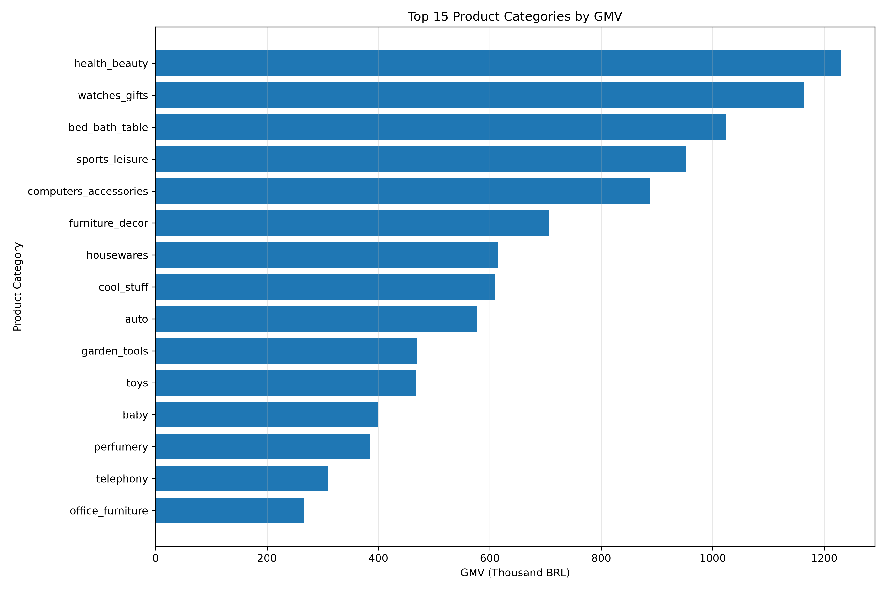
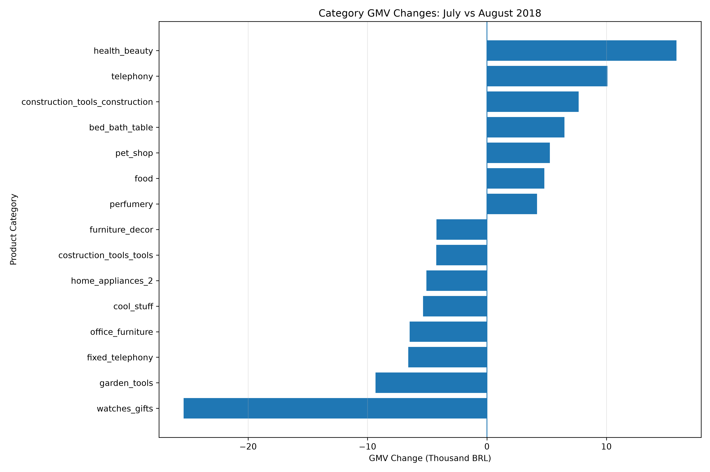
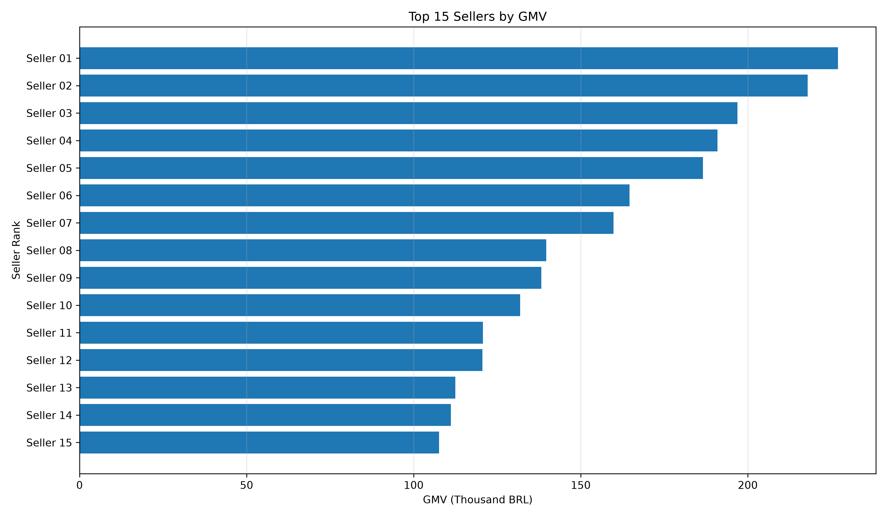
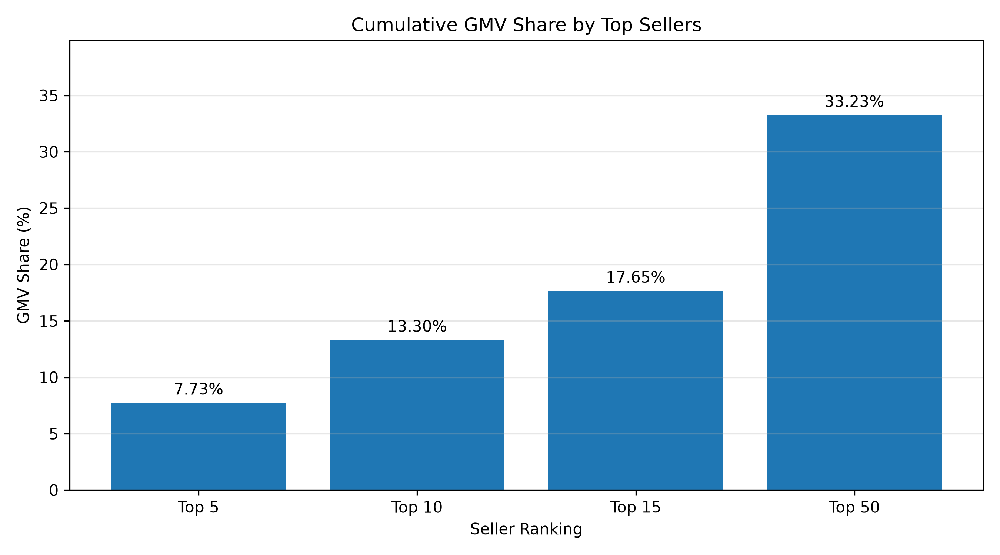
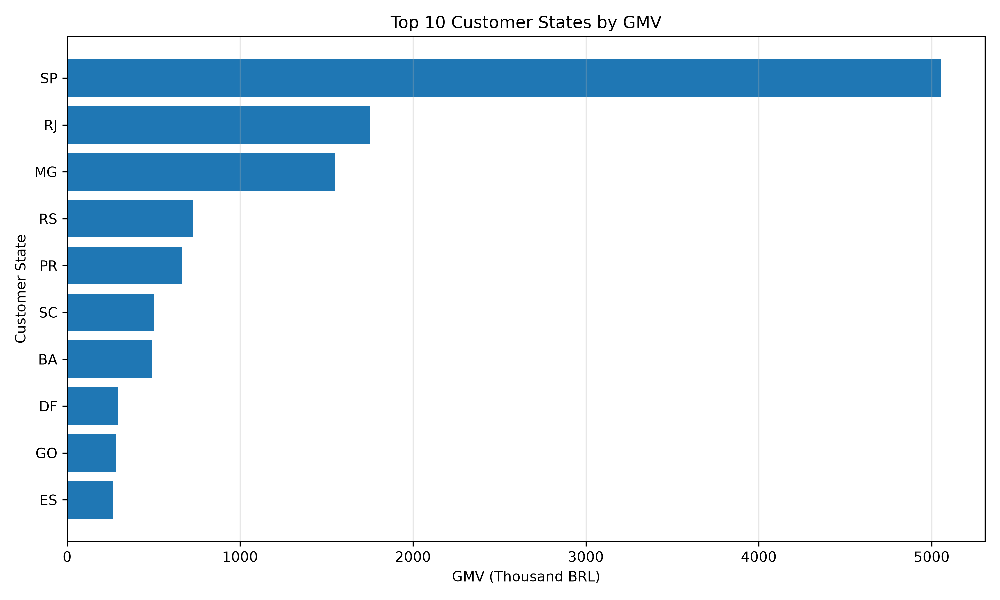
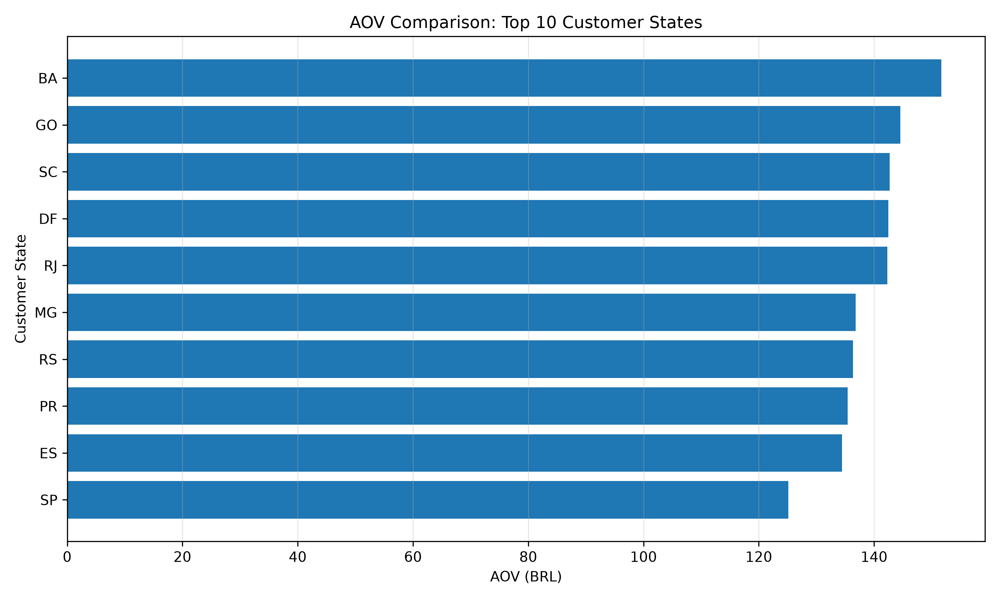
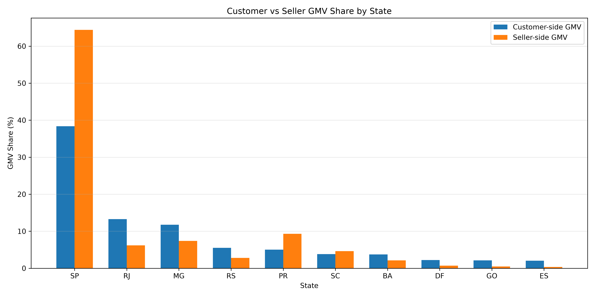

# Olist 电商数据分析｜第四阶段：商品、商家与地区分析

**分析期间：** 2017 年 1 月—2018 年 8 月（按订单购买月份）  
**统一口径：** 仅分析最终已送达且有商品明细的订单；GMV = 商品明细 `price` 之和，不含运费。样本包含 **96,211 笔有效订单、109,880 条商品明细**，GMV 合计 **R$13,181,027.13**。

## 核心发现

Olist 的商品交易额存在**品类与地域集中、商家相对分散**的结构特征：Top 5 商品品类贡献 **39.88%** 的 GMV，Top 5 商家仅贡献 **7.73%**；买家侧前三州贡献 **63.40%**，而商家侧仅 SP 一州便贡献 **64.39%**。同时，2018 年 8 月的 AOV 回落主要体现为**平均商品明细金额下降**，而不是每单商品明细数明显减少。这些结果提供了经营诊断线索，但尚不能证明具体的营销、定价或跨州物流原因。

## 一、商品销售额集中于头部品类，数量与价格的贡献不同

| GMV 排名 | 品类 | 商品明细数 | GMV（R$） | GMV 占比 | 平均明细金额（R$） |
|---|---|---:|---:|---:|---:|
| 1 | health_beauty | 9,422 | 1,229,557.50 | 9.33% | 130.50 |
| 2 | watches_gifts | 5,855 | 1,163,465.91 | 8.83% | 198.71 |
| 3 | bed_bath_table | 10,945 | 1,022,955.77 | 7.76% | 93.46 |
| 4 | sports_leisure | 8,414 | 952,840.40 | 7.23% | 113.24 |
| 5 | computers_accessories | 7,632 | 888,055.59 | 6.74% | 116.36 |

Top 5 / Top 10 / Top 15 品类分别贡献 **39.88% / 62.47% / 76.33%** 的 GMV。头部品类重要，但没有单一品类占据绝对主导地位。

值得注意的是，`bed_bath_table` 的明细数量更多，平均明细金额只有 **R$93.46**；`watches_gifts` 明细数量更少，平均金额却达到 **R$198.71**，最终 GMV 排名更高。**GMV 排名不能直接当作商品热度或购买频次排名**，需要同时观察明细数量、订单数与平均商品明细金额。

## 二、2018 年 8 月 GMV 下滑：品类分化与平均明细金额回落并存

第三阶段发现，2018 年 8 月有效订单量环比增加 **3.12%**，但 GMV 下降 **3.38%**、AOV 下降 **6.31%**。本阶段进一步把这一现象拆解到商品层面。

**品类变化并非普遍下滑。** 7—8 月间，`watches_gifts` 的 GMV 减少 **R$25,397.73**，占本期平台 GMV 净下降额 **R$29,376.82** 的约 **86.5%**；另一方面，`health_beauty` 增加 **R$15,866.79**、`telephony` 增加 **R$10,080.23**。其他品类的增减相互抵消，因此 86.5% 只是与净变化额的比例，不代表手表礼品品类独自“导致”了 86.5% 的下降。

**AOV 的算术分解更加明确：**

| 指标 | 2018-07 | 2018-08 | 环比变化 |
|---|---:|---:|---:|
| 有效已送达订单 | 6,159 | 6,351 | +3.12% |
| 商品明细行数 | 6,963 | 7,142 | +2.57% |
| GMV（R$） | 867,953.46 | 838,576.64 | -3.38% |
| 每单平均商品明细数 | 1.1305 | 1.1245 | 约 -0.53% |
| 平均商品明细金额（R$） | 124.65 | 117.41 | 约 -5.81% |
| AOV（R$） | 140.92 | 132.04 | -6.31% |

由 **AOV = 每单平均商品明细数 × 平均商品明细金额** 可知，AOV 下滑主要体现在平均商品明细金额下降；每单商品明细数变化很小。这与前述品类销售额重排相互呼应，提示需要关注**品类与商品价格结构**。但不同商品的销售占比变化与同款商品实际降价，是两种不同解释，当前结果无法将其区分，更不能认定促销是原因。

## 三、商家端有头部效应，但没有明显的单一商家依赖

分析期间共有 **2,945 家活跃商家**。商家 GMV 集中度如下：

| 商家范围 | GMV 占比 |
|---|---:|
| Top 1 | 1.72% |
| Top 5 | 7.73% |
| Top 10 | 13.30% |
| Top 15 | 17.65% |
| Top 50 | 33.23% |

Top 50 商家只占活跃商家的约 **1.70%**，却贡献约三分之一的 GMV，说明商家销售额分布存在头部效应；但第一大商家只有 **1.72%**，平台并没有在本样本中呈现明显的单一商家依赖。

头部商家的交易方式也不同：GMV 第二高的商家仅有 **400** 条商品明细、平均金额 **R$544.85**；第三名有 **1,949** 条明细、平均金额 **R$101.02**。因此单看商家 GMV，不足以判断其销量优势、商品定位或盈利能力。

**与品类集中度对照：** Top 5 品类贡献 39.88%，Top 5 商家贡献 7.73%。这一差异描述了两种维度下的头部贡献情况；由于品类与商家的总数量不同，不能直接据此判断竞争格局或商家议价能力。

## 四、消费市场高度集中于少数州，但高 GMV 不等于高 AOV

买家覆盖 **27 个州及联邦单位**。主要市场如下：

| 买家州 | 有效订单 | GMV（R$） | GMV 占比 | AOV（R$） |
|---|---:|---:|---:|---:|
| SP | 40,406 | 5,055,587.13 | 38.36% | 125.12 |
| RJ | 12,310 | 1,751,433.85 | 13.29% | 142.28 |
| MG | 11,319 | 1,548,206.88 | 11.75% | 136.78 |
| RS | 5,328 | 726,373.92 | 5.51% | 136.33 |
| PR | 4,903 | 664,048.00 | 5.04% | 135.44 |

SP、RJ、MG 三州合计贡献 **63.40%** 的 GMV；Top 5 州合计贡献 **73.95%**。其中 SP 单州贡献 **38.36%** 的 GMV、约 **42.00%** 的有效订单，是平台最重要的消费市场。

但 SP 的 AOV 仅为 **R$125.12**，低于全区间 AOV **R$137.00**。在 GMV 前十州中，BA 的 AOV 为 **R$151.66**，高于 SP。这说明**市场交易规模和单笔订单金额不是同一个维度**：SP 的规模优势主要体现为订单数量，而不能据此评价地区居民的收入或消费能力。

## 五、地区商品结构有共性，也有差异

在 GMV 最高的五个买家州中，**SP、RJ、MG 的前三大品类相同**，均包括 `bed_bath_table`、`health_beauty`、`watches_gifts`，只是排序不同；PR 的首位品类为 `sports_leisure`，RS 的前三则包含 `furniture_decor` 与 `computers_accessories`。

各州前三大品类合计贡献本州 GMV 的 **22.84%—26.63%**。这表明不同州的交易额既有共同的核心品类，也存在局部结构差异。不过，“某品类在该州排第一”不代表该州居民比其他州更偏爱它；要判断相对偏好，还需要用跨州标准化的品类占比或人均指标比较。

## 六、商家侧比买家侧更加集中于 SP，供需地域归属不对称

平台有活跃商家的州为 **22 个**，少于有买家的 27 个州及联邦单位。SP 集中了 **1,751 家商家（59.46%）**，贡献 **64.39%** 的商家侧 GMV。

| 州 | 买家侧 GMV 占比 | 商家侧 GMV 占比 | 商家侧减买家侧（百分点） |
|---|---:|---:|---:|
| SP | 38.36% | 64.39% | +26.03 |
| RJ | 13.29% | 6.17% | -7.12 |
| MG | 11.75% | 7.40% | -4.35 |
| PR | 5.04% | 9.30% | +4.26 |
| SC | 3.83% | 4.65% | +0.82 |

商家侧 Top 3 州贡献 **81.09%** 的 GMV，集中度高于买家侧 Top 3 州的 **63.40%**。两端均以 SP 为核心，但商家端的地域聚集更加突出。**这种不对称值得进一步检验跨州交易路径及配送效率，却不能把占比差直接解释为跨州交易额或供需缺口。**

## 七、综合经营判断与后续验证方向

1. **品类结构是理解平台 GMV 的重要切入点。** 头部品类贡献显著，但销售额排名受到明细数量和平均商品金额共同影响，品类运营不能只看 GMV。
2. **2018 年 8 月 AOV 下滑的近端算术来源已经明确。** 平均商品明细金额下降幅度远大于每单明细数变化；下一步若要识别业务原因，应区分商品组合变化与同款商品价格变化。
3. **商家端存在头部效应而非单一商家依赖。** 若评估商家经营风险，还应看单个品类内的商家集中度、履约表现与利润贡献，不能用 GMV 占比替代。
4. **消费端与供给端均存在地域集中，且聚集程度不同。** 若要评价仓配或跨州履约，可按买家州 × 商家州建立真实交易流向，再结合配送时间、运费及订单规模进行验证。
5. **地区市场分析应兼顾订单规模、AOV 与商品结构。** 高 GMV 不等于高客单价，也不直接等于更强消费能力。

## 分析边界与依据

- 商品品类关联前后均为 **109,880 条明细**，GMV 均为 **R$13,181,027.13**；共 **74 个品类标签（含 `unknown`）**，其中 **1,535 条明细（1.40%）**的品类为 `unknown`，这些金额保留在总 GMV 中。
- “商品明细数”不是去重 SKU 数；按商家州分别统计的订单参与数不能相加为平台去重订单数；GMV 不等于收入、利润或实际收款。
- 全部结论来自已执行的 `sql/06_product_region.sql` 查询结果、`notebooks/03_product_region.ipynb` 所生成图表；属于历史交易样本的描述性分析。末期订单状态可能受履约观察期限制，地区间还缺少人口、覆盖率和供给数据等外部基准。
