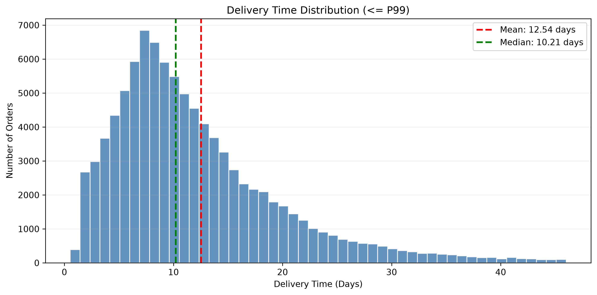
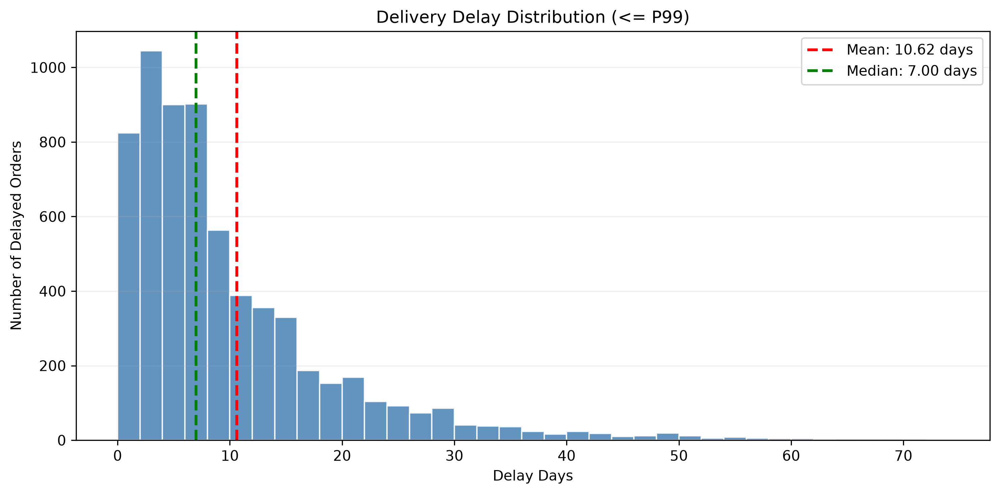
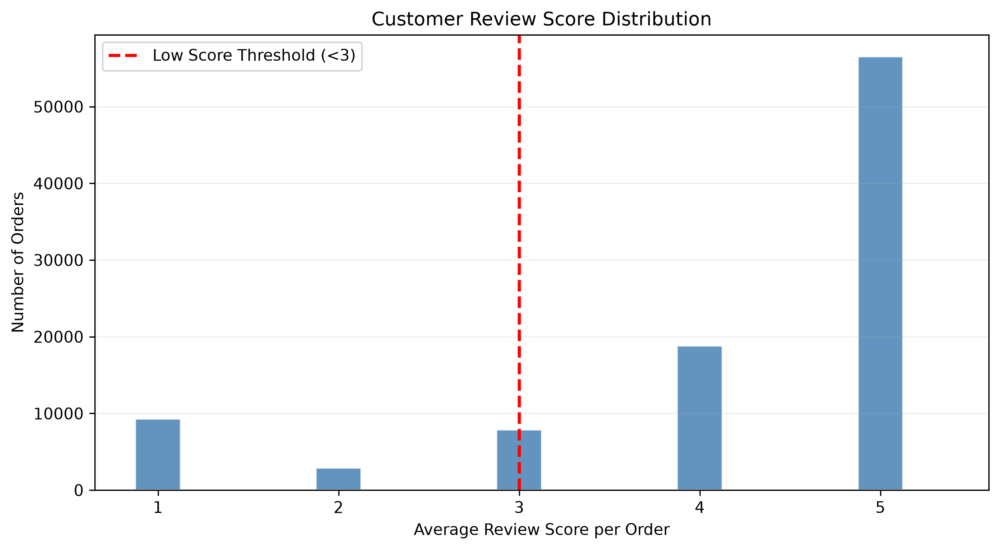
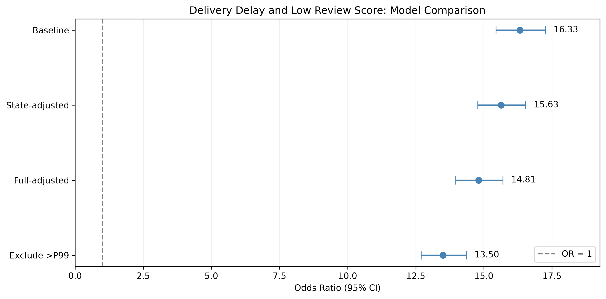

# Olist 电商平台｜第七阶段统计分析与业务诊断报告

## 1. 分析背景与目标

本阶段基于 Olist 巴西电商交易数据，进一步研究配送效率与用户评价之间的统计关系。

前期业务分析发现，配送延迟订单的平均评分明显低于准时订单。因此，本阶段通过描述性统计、假设检验、Logistic 回归及敏感性分析，验证两者之间的统计关联及其稳定性。

核心研究问题：

1. 配送时间与延迟天数具有怎样的分布特征？
2. 延迟订单与准时订单的用户评分是否存在显著差异？
3. 控制地区、订单金额及购买月份后，配送延迟与低评分的关联是否仍然存在？
4. 改变低评分阈值或排除极端配送订单后，统计结论是否保持稳定？

## 2. 数据来源与分析口径

**数据来源：** Olist Brazilian E-Commerce Public Dataset

**分析区间：** 2017 年 1 月至 2018 年 8 月，以订单购买时间为准。

**数据粒度：** 一行对应一笔订单。

| 指标 | 数量 |
|---|---:|
| 有效配送订单 | 96,203 |
| 有效评价订单 | 95,560 |
| 缺失评价订单 | 643 |
| 延迟订单 | 6,531 |
| 准时或提前订单 | 89,672 |

本阶段以订单平均评价分数作为评分指标，低评分定义为订单平均评分小于 3 分。

主要变量包括：

- `is_delayed`：是否延迟配送。
- `delivery_days`：实际配送天数。
- `delay_days`：相对预计送达日期的延迟天数。
- `avg_review_score`：订单平均评价分数。
- `order_amount`：订单商品金额，不含运费。
- `customer_state`：买家所在州。
- `purchase_month`：订单购买月份。

统计建模仅使用具有有效评分记录的订单。

## 3. 描述性统计分析

### 3.1 配送时间分布

| 指标 | 结果 |
|---|---:|
| 平均配送时间 | 12.54 天 |
| 配送时间中位数 | 10.21 天 |
| 标准差 | 9.53 天 |
| P90 | 23.06 天 |
| P95 | 29.22 天 |
| P99 | 46.01 天 |
| 最大配送时间 | 209.63 天 |

实际配送时间呈右偏分布，大部分订单集中于相对较短的配送周期，少量长配送订单形成明显长尾。

配送时间达到 30 天的订单共有 4,502 笔，占有效配送订单的 4.68%。

### 3.2 延迟天数分布

延迟订单共 6,531 笔，平均延误 10.62 天，中位延误 7 天。

延迟天数同样呈右偏分布，短期延迟订单占比较高，但存在最长达到 188 天的严重延迟记录。

### 3.3 用户评分分布

用户评分明显集中于高分区间，5 分订单最多，整体分布不对称。

在具有有效评价的订单中，准时订单平均评分为 4.291 分，延迟订单平均评分为 2.272 分。

## 4. 统计假设检验

### 4.1 Pearson 卡方独立性检验

研究配送延迟与低评分之间是否存在统计关联。

原假设 H₀：配送是否延迟与是否出现低评分相互独立。

检验结果：

| 指标 | 结果 |
|---|---:|
| χ² | 15,099.9346 |
| 自由度 | 1 |
| p-value | < 0.001 |
| 准时订单低评分率 | 9.24% |
| 延迟订单低评分率 | 62.43% |

检验结果拒绝原假设，说明配送延迟与低评分之间存在显著统计关联。

### 4.2 效应量分析

| 效应量 | 结果 | 95% CI |
|---|---:|---|
| 风险差 RD | 53.19 个百分点 | [51.99, 54.40] |
| 相对风险 RR | 6.757 | [6.570, 6.949] |
| 优势比 OR | 16.325 | [15.444, 17.257] |

延迟订单的低评分概率约为准时订单的 6.76 倍，反映出较大的组间差异。

### 4.3 Mann–Whitney U 检验

考虑到评分分布具有明显的非正态特征，采用非参数检验比较两组评分分布。

结果如下：

- U statistic：102,904,249
- p-value：< 0.001
- Rank-biserial correlation：-0.6382

结果表明，两组评分分布存在显著差异，延迟订单评分在相对排序上明显偏低。

## 5. Logistic 回归分析

### 5.1 模型设计

因变量为是否出现低评分（订单平均评分小于 3 分）。

建立三个递进模型：

- Model 1：仅包含配送延迟。
- Model 2：配送延迟 + 买家州。
- Model 3：配送延迟 + 买家州 + 订单商品金额 + 购买月份。

订单金额采用 `log1p()` 变换。

### 5.2 模型结果

| 模型 | 延迟 OR | OR 95% CI | Pseudo R² |
|---|---:|---|---:|
| Model 1 | 16.3253 | [15.4437, 17.2572] | 0.1326 |
| Model 2 | 15.6324 | [14.7762, 16.5381] | 0.1349 |
| Model 3 | 14.8098 | [13.9697, 15.7003] | 0.1404 |

三个模型均成功收敛，配送延迟变量的统计显著性均达到 p < 0.001。

完整调整模型中，配送延迟的 OR 为 14.81，说明在控制买家州、订单金额与购买月份后，延迟订单仍具有明显更高的低评分优势。

订单金额对数变量的 OR 为 1.1707，95% CI 为 [1.1447, 1.1973]，同样具有统计显著性。

上述结果反映条件关联，不代表变量之间存在已验证的因果关系。

## 6. 敏感性分析

### 6.1 低评分阈值敏感性

分别采用订单平均评分小于 3 分和小于 4 分作为低评分标准。

| 低评分阈值 | 调整后 OR | 95% CI |
|---|---:|---|
| 评分 < 3 | 14.8098 | [13.9697, 15.7003] |
| 评分 < 4 | 11.8638 | [11.1742, 12.5959] |

两种评分定义下，配送延迟均与更高的低评分优势显著相关。

但 OR 的变化说明，关联强度受到低评分定义的影响。

### 6.2 极端配送订单敏感性

以具有有效评价的 95,560 笔订单为样本，排除实际配送时间超过 P99（45.82 天）的订单。

共排除 956 笔订单，占原建模样本的 1.00%。

| 模型 | 样本量 | 调整后 OR | 95% CI |
|---|---:|---:|---|
| 完整样本 | 95,560 | 14.8098 | [13.9697, 15.7003] |
| 排除 P99 以上订单 | 94,604 | 13.5000 | [12.6954, 14.3556] |

排除极端配送订单后，关联仍然显著，表明结果并非完全由少量极端订单支撑。

## 7. 业务诊断与策略建议

### 7.1 核心业务发现

**发现一：配送延迟是与用户低评分高度相关的业务信号。**

延迟订单的低评分率达到 62.43%，明显高于准时订单的 9.24%。

这一差异具有统计显著性，且在控制地区、订单金额和购买月份后仍然存在。

**发现二：严重延迟订单需要重点关注。**

延迟天数存在明显长尾，部分订单具有较长的延误时间。

这类订单可能面临更复杂的履约问题，值得开展专项排查。

**发现三：关联结果具有一定稳定性。**

改变低评分阈值以及排除配送时间最长的 1% 订单后，配送延迟与低评分的正向关联仍然显著。

### 7.2 业务建议

**建议一：建立配送异常监控机制。**

持续跟踪各地区的延迟订单数量、延迟率和延误天数，优先关注延迟率较高且订单规模较大的地区。

**建议二：建立严重延迟订单分级处理机制。**

根据订单延误程度设置不同的跟进优先级，对长时间延误的订单开展物流节点排查、客户通知和服务补救。

**建议三：将配送质量纳入用户体验分析体系。**

联合监控配送效率、延迟程度、评价分数和低评分率，进一步识别值得关注的履约问题。

以上建议属于依据观察性数据提出的业务改进方向，具体效果仍需通过实际业务试点或实验验证。

## 8. 分析局限性

本阶段存在以下限制：

1. **观察性数据限制**：统计关联不能证明配送延迟直接导致低评分。
2. **控制变量有限**：尚未控制具体商品、商家、物流服务商和客户预期等可能相关的因素。
3. **样本选择限制**：回归样本仅包含最终已送达、配送时间有效且存在评价的订单，可能存在选择偏差。
4. **评价指标限制**：使用订单平均评分表示用户体验，不能完整反映用户主观满意度。
5. **时间信息限制**：数据记录的是历史订单的最终履约状态，并不构成实时预测数据。
6. **模型解释限制**：Logistic 回归 OR 不是概率比；Pseudo R² 也不是传统线性回归的解释方差比例。

## 9. 阶段总结

本阶段通过描述性统计、Pearson 卡方检验、Mann–Whitney U 检验、效应量计算、多变量 Logistic 回归以及敏感性分析，对配送延迟和用户低评分之间的统计关系进行了系统研究。

**核心结论：**

Olist 样本中，配送延迟与用户低评分存在显著且较强的正向关联。控制买家州、订单金额和购买月份后，关联仍然显著。改变评分阈值及排除极端配送订单后，统计结论保持稳定。

这些发现支持将配送延迟作为用户体验监控和业务诊断的重要指标，但不能直接解释为已经识别出的因果效应。

本报告仅总结第七阶段统计分析结果，不代表整个 Olist 电商分析项目的最终综合结论。